<p align="center">
  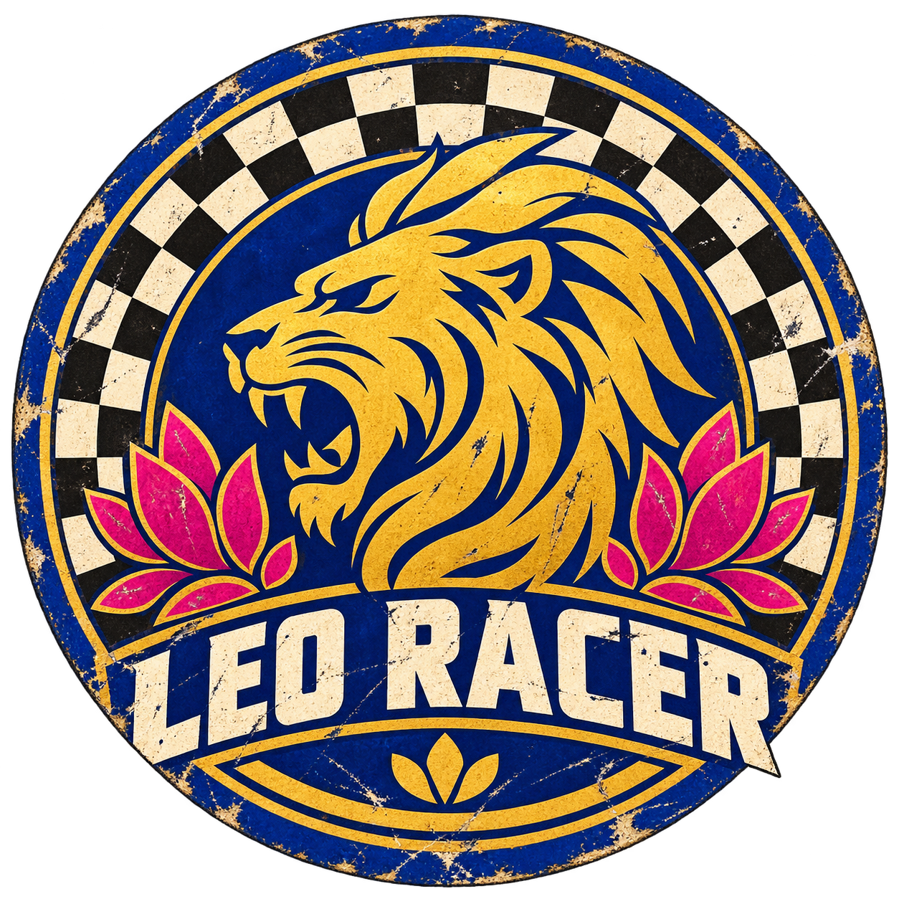
</p>

<h1 align="center">LEO RACER</h1>

<p align="center">
  <strong>Island roads. Arcade rules.</strong><br>
  Drift the coast, race the city, and find your line around Kandy Lake.
</p>

<p align="center">
  <a href="https://github.com/amilapcsgit/Leo_Racer/releases/latest"></a>
  
  
  
</p>

<p align="center">
  <a href="https://github.com/amilapcsgit/Leo_Racer/releases/latest/download/LeoRacer-Setup.exe"></a>
  <a href="https://github.com/amilapcsgit/Leo_Racer/releases/latest"></a>
</p>

<p align="center">
  <a href="#download">Install</a> &nbsp; · &nbsp;
  <a href="#tracks">Tracks</a> &nbsp; · &nbsp;
  <a href="#the-race">The race</a> &nbsp; · &nbsp;
  <a href="#garage">Garage</a> &nbsp; · &nbsp;
  <a href="#controls">Controls</a> &nbsp; · &nbsp;
  <a href="#artbook">Artbook</a> &nbsp; · &nbsp;
  <a href="#build--create">Build &amp; create</a>
</p>

<p align="center">
  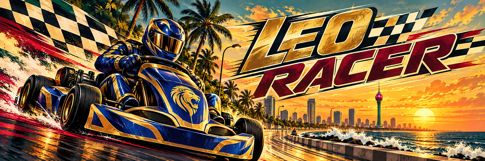
  <br><sub>Original promotional artwork. Actual gameplay captures appear below.</sub>
</p>

<table>
  <tr>
    <td align="center" width="25%"><h3>3</h3><strong>Sri Lankan circuits</strong><br><sub>Coast · City · Hill country</sub></td>
    <td align="center" width="25%"><h3>6</h3><strong>Racers on the grid</strong><br><sub>Three laps. Find your opening.</sub></td>
    <td align="center" width="25%"><h3>1–2</h3><strong>Local players</strong><br><sub>Solo or vertical split-screen</sub></td>
    <td align="center" width="25%"><h3>48</h3><strong>Available cars</strong><br><sub>16 default + 32 additional</sub></td>
  </tr>
</table>

**Leo Racer** is a Windows arcade racer set on stylized Sri Lankan roads. Charge a drift, catch a slipstream, and spend your nitro on the next straight. Take on five AI rivals or share the screen with a friend. Pick a driver, pick a ride, and chase a better lap.

## Download

**[Download the latest Windows installer](https://github.com/amilapcsgit/Leo_Racer/releases/latest/download/LeoRacer-Setup.exe)** — everything is bundled for offline installation and play.

<table>
  <tr>
    <th width="33%">COMPLETE</th>
    <th width="33%">STANDARD</th>
    <th width="33%">CUSTOM</th>
  </tr>
  <tr>
    <td align="center"><strong>The whole garage.</strong><br>All 3 tracks<br>All 48 cars</td>
    <td align="center"><strong>The original grid.</strong><br>All 3 tracks<br>16 default cars</td>
    <td align="center"><strong>Your selection.</strong><br>Choose tracks and additional cars<br>16 default cars retained</td>
  </tr>
</table>

No Godot installation, separate .NET installation, account, or internet connection is needed to play. Custom installation requires at least one track.

Prefer a ZIP? **[Portable v2.3.2](https://github.com/amilapcsgit/Leo_Racer/releases/download/v2.3.2/LeoRacer-2.3.2-win64.zip)** includes three tracks and 16 cars. Extract the **complete folder** and run `LeoRacer.exe`. The **[additional-car pack](https://github.com/amilapcsgit/Leo_Racer/releases/download/v2.3.2/LeoRacer-AdditionalCars-2.3.2.zip)** supplies the other 32.

<details>
<summary><strong>Upgrading, Compatibility mode &amp; checksums</strong></summary>

- Existing settings, control profiles, records, and user-added cars keep their locations.
- Replaced modified files are backed up under `ContentBackups`. Deselecting installed content preserves it.
- Use `Play Compatibility.cmd` if Vulkan is unavailable. Forward+ is recommended; Compatibility uses simpler effects and may show frame spikes.
- [Release notes, SHA256 checksums, evidence, and earlier versions](https://github.com/amilapcsgit/Leo_Racer/releases). Previous releases remain available for rollback.

</details>

## Tracks

<p align="center"><strong>One island. Three different racing lines.</strong></p>

<table>
  <tr>
    <td width="33%" valign="top">
      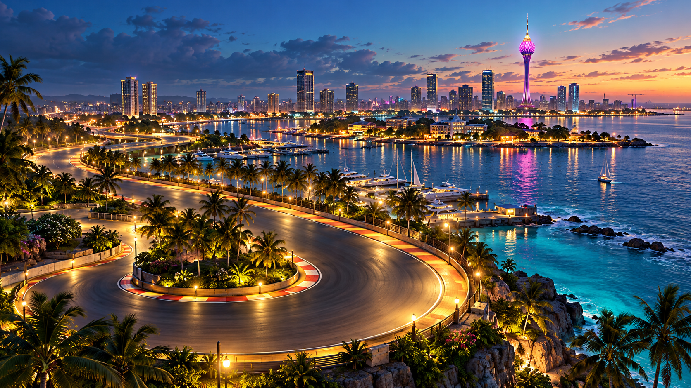
      <h3>Astra Lotus Coast</h3>
      <strong>1.9 km · Coastal circuit</strong>
      <p>Palm-lined straights, Port City esses, a harbor hairpin, lagoon causeway, and a Lotus Tower skyline.</p>
    </td>
    <td width="33%" valign="top">
      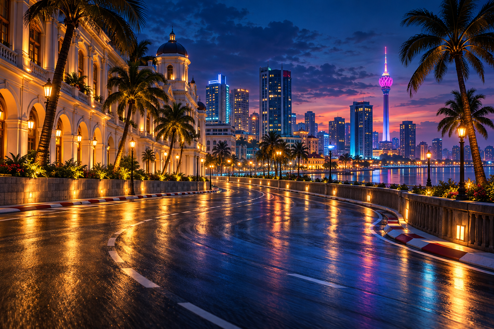
      <h3>Colombo City Grand Prix</h3>
      <strong>5.5 km · Urban circuit</strong>
      <p>Fort streets, tropical gardens, lake shores, and the Galle Face coastline across a longer city lap.</p>
    </td>
    <td width="33%" valign="top">
      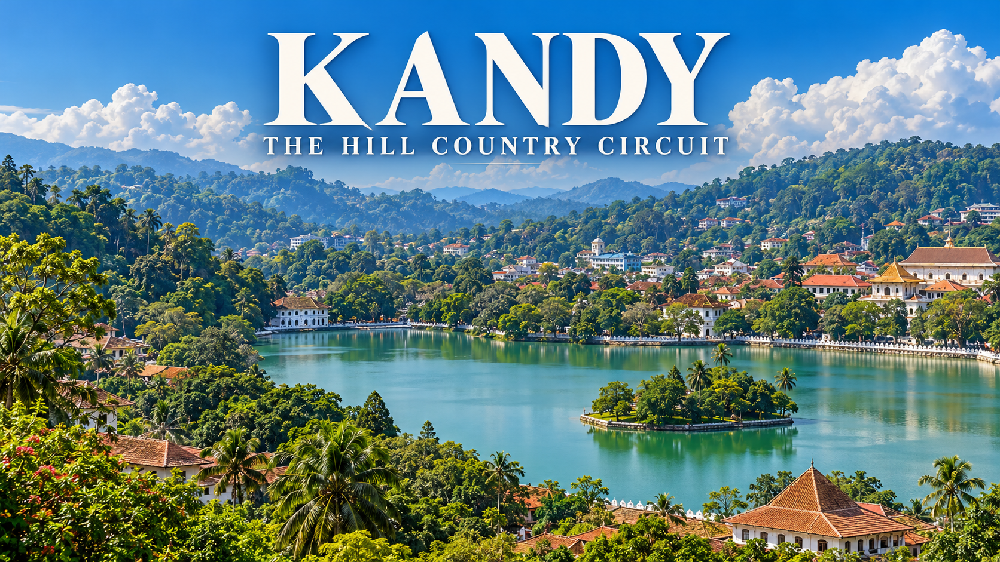
      <h3>Kandy Lake Circuit</h3>
      <strong>2.83 km · Lakeside circuit</strong>
      <p>Hill-country daylight, wooded ridgelines, Buddhist landmarks, local signs, and a physical start arch.</p>
    </td>
  </tr>
</table>

<sub>Track cards use promotional artwork. The game uses stylized 3D scenery; screenshots below show the playable world.</sub>

<details>
<summary><strong>Explore the circuits in game</strong></summary>

<p>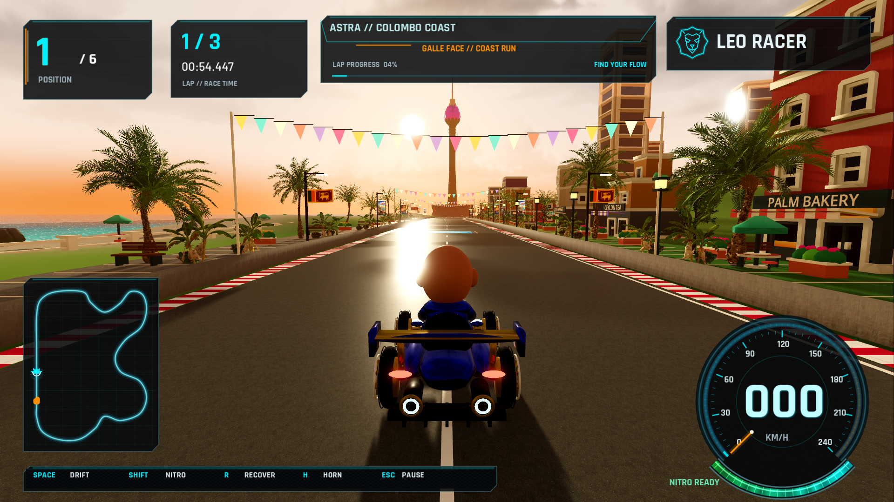<br><sub>Astra Lotus Coast · coastal racing line.</sub></p>
<p>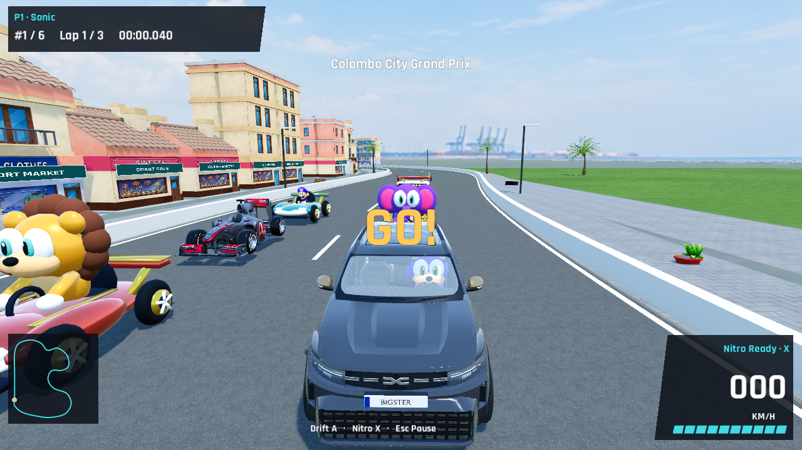<br><sub>Colombo City Grand Prix · reverse camera.</sub></p>
<p>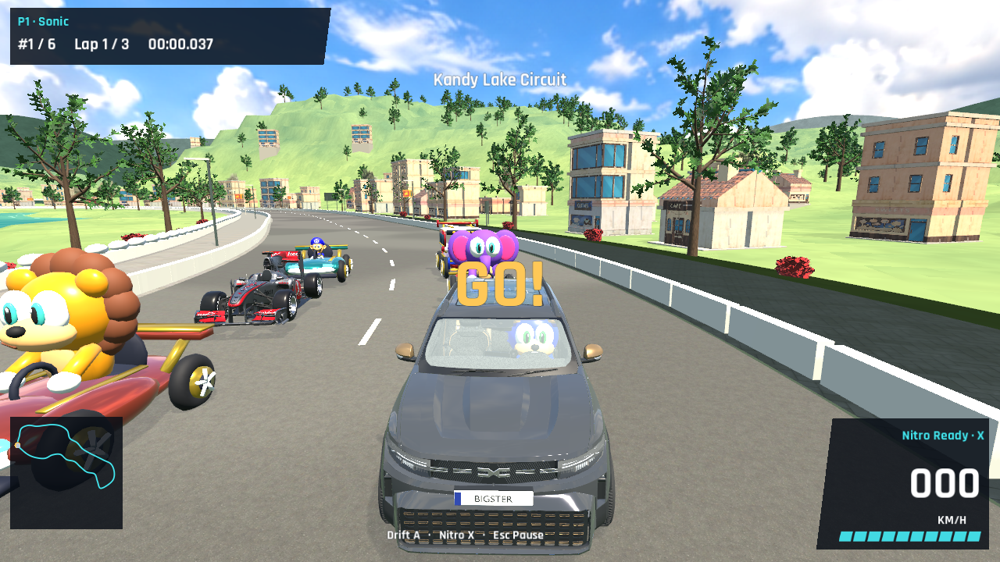<br><sub>Kandy Lake Circuit · the hill-country course.</sub></p>

[Coast pipeline](docs/ASTRA_SETUP.md) · [Colombo scenery](docs/COLOMBO_VISUALS.md) · [Kandy landmarks and lighting](docs/KANDY_231.md)

</details>

## The race

<table>
  <tr>
    <td width="50%" valign="top">
      <h3>Charge the corner.</h3>
      <p>Hold a drift through the turn, then release a charged drift for a mini-turbo. Hold the line longer to earn <strong>SUPER DRIFT</strong>.</p>
      <p>Recharge nitro through drifting and slipstreaming. Time your throttle on the final countdown beat for a launch boost.</p>
    </td>
    <td width="50%" valign="top">
      <h3>Share the screen.</h3>
      <p>Race solo against five AI drivers, or choose <strong>Go Race → 2 Players</strong> for two humans and four AI.</p>
      <p>Choose separate names, drivers, rides, and input devices. P1 races on the left; P2 races on the right and keeps going when P1 finishes.</p>
    </td>
  </tr>
</table>

<p align="center">
  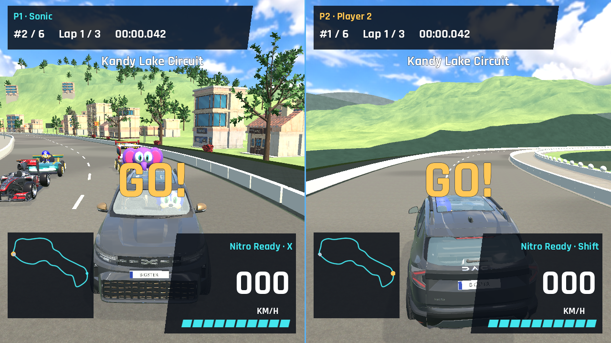
  <br><sub>Actual gameplay · independent cameras for both local players.</sub>
</p>

**One more lap.** Offline lap and race records track your progress by mode, performance class, and vehicle. Ordered checkpoints keep the race fair; modified or unfinished races do not set official records.

## Garage

<p align="center">
  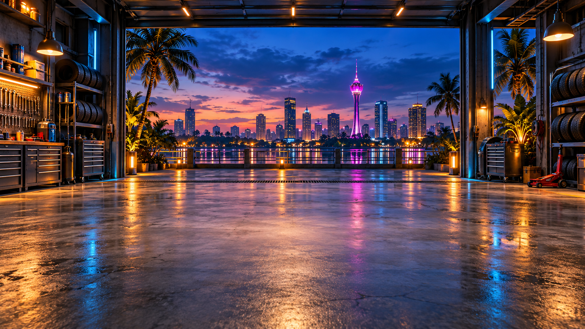
  <br><sub>Garage environment artwork.</sub>
</p>

### Pick something with personality.

Karts, Formula racers, a racing tuk-tuk, a bus, sports cars, and both Dacias share the default garage. Install the additional pack to bring the total to **48 available cars**. Imported additional cars are unranked and have no visible driver.

<table>
  <tr>
    <td width="50%" valign="top">
      <h3>Working lights. Moving parts.</h3>
      <p><strong>Bigster 1.2.1</strong> brings red Y-shaped rear LEDs, a separate white bumper reversing lamp, working main headlights, and a sliding sunroof.</p>
      <p>Toggle the headlights, open the roof, and keep each racer's light and action states independent.</p>
    </td>
    <td width="50%" valign="top">
      <h3>See every side.</h3>
      <p>Reverse for an automatic front-of-car view. Hold <strong>Look Back</strong>, or orbit with a mouse drag or the right stick.</p>
      <p>Camera smoothing, recentering, and terrain/wall avoidance work with independent split-screen cameras.</p>
    </td>
  </tr>
</table>

<details>
<summary><strong>See Bigster's lights and sunroof</strong></summary>

<p>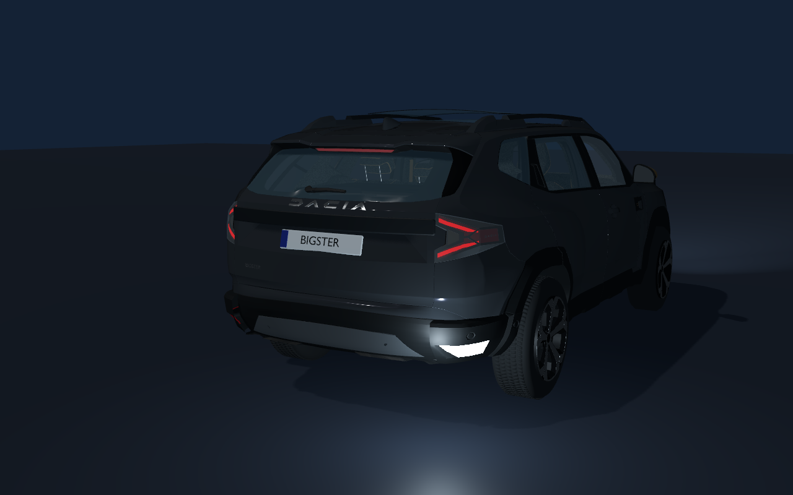<br><sub>Rear optical groups · white reverse light below the bumper.</sub></p>
<p>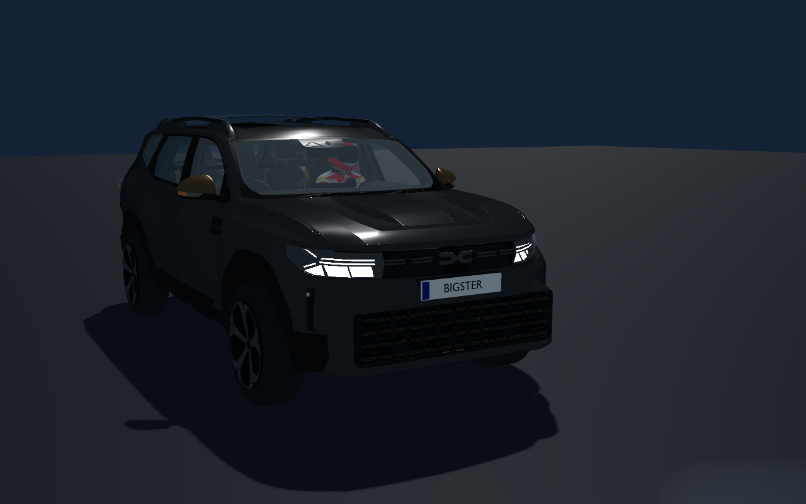<br><sub>Main headlights and signature strips.</sub></p>
<p>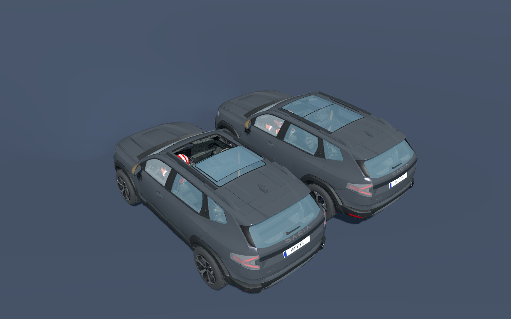<br><sub>Action 1 · open on the left, closed on the right.</sub></p>

Other vehicles can opt into lights and actions through Workshop metadata. This release does not add new lamp geometry or actions to every car. [Vehicle features and authoring guide](docs/VEHICLE_FEATURES.md).

</details>

### Make it yours in Workshop.

Open **Content → Vehicles → Set Up Vehicle** to configure a portable car, bind lamp surfaces and anchors, name vehicle actions, preview them, and take a private test drive. Compatible vehicle and track packages can be updated independently of the executable.

[Vehicle authoring](docs/VEHICLE_FEATURES.md) · [Contributor SDK](sdk/README.md) · [Modular content](docs/MODULARITY_VALIDATION.md)

## Controls

<table>
  <tr><th>Action</th><th>Keyboard</th><th>Controller</th></tr>
  <tr><td>Accelerate / brake / reverse</td><td><kbd>W</kbd> / <kbd>S</kbd> or arrow keys</td><td>Triggers</td></tr>
  <tr><td>Steer</td><td><kbd>A</kbd> / <kbd>D</kbd> or arrow keys</td><td>Left stick</td></tr>
  <tr><td>Drift / nitro</td><td><kbd>Space</kbd> / <kbd>Shift</kbd></td><td>A / X</td></tr>
  <tr><td>Recover / horn</td><td><kbd>R</kbd> / <kbd>H</kbd></td><td>Y / B</td></tr>
  <tr><td>Headlights</td><td><kbd>L</kbd></td><td>D-pad left</td></tr>
  <tr><td>Vehicle Action 1 · Bigster sunroof</td><td><kbd>O</kbd></td><td>D-pad up</td></tr>
  <tr><td>Vehicle Action 2</td><td><kbd>K</kbd></td><td>D-pad down</td></tr>
  <tr><td>Look Back · hold</td><td><kbd>C</kbd></td><td>Right-stick click</td></tr>
  <tr><td>Orbit camera</td><td>Right-mouse drag</td><td>Right stick</td></tr>
  <tr><td>Pause</td><td><kbd>Esc</kbd> or <kbd>P</kbd></td><td>Start</td></tr>
  <tr><td>Hide HUD for photos</td><td><kbd>F8</kbd></td><td>—</td></tr>
</table>

<details>
<summary><strong>Remapping, shared keyboards &amp; Reduced Motion</strong></summary>

**Race Setup → Controls** saves per-player bindings and calibration for keyboard, mapped controllers, and raw joystick/wheel axes. Each pad or wheel belongs to one player. Shared-keyboard presets use complementary WASD/arrow layouts; P2 uses Numpad 1/2/3/0 for the new feature buttons.

Existing assignments take precedence over conflicting new defaults. Bigster's Action 2 is unassigned. An assigned-device disconnect pauses both players until reassignment or retirement.

**Reduced Motion** disables camera kicks, roll, shake, recovery distortion, and decorative UI movement while retaining useful visual feedback. Physical wheel compatibility remains unverified; force feedback is not included.

</details>

## Artbook

<p align="center">
  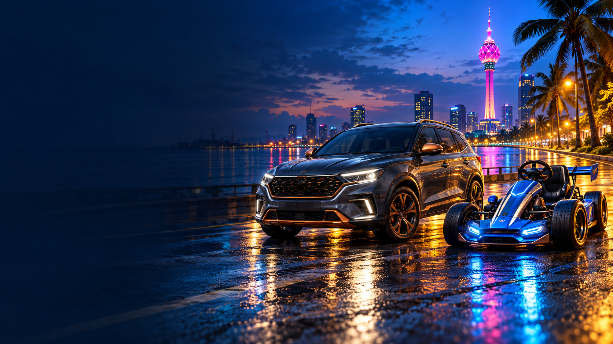
  <br><sub>Colombo after dark · home-screen hero artwork.</sub>
</p>

<details>
<summary><strong>Open the full artwork gallery · day, night, racing posters &amp; emblems</strong></summary>

<table>
  <tr>
    <td width="50%" valign="top">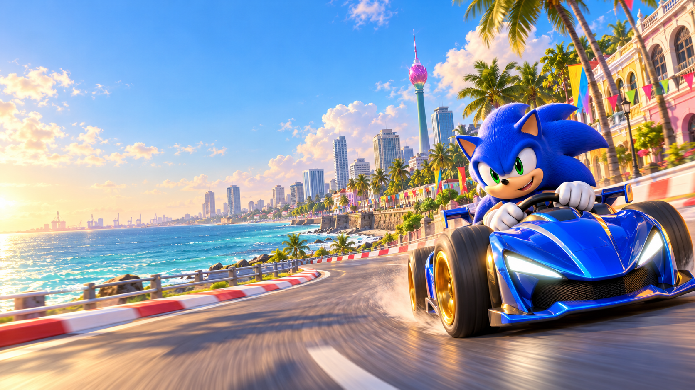<br><sub>Daylight menu artwork.</sub></td>
    <td width="50%" valign="top">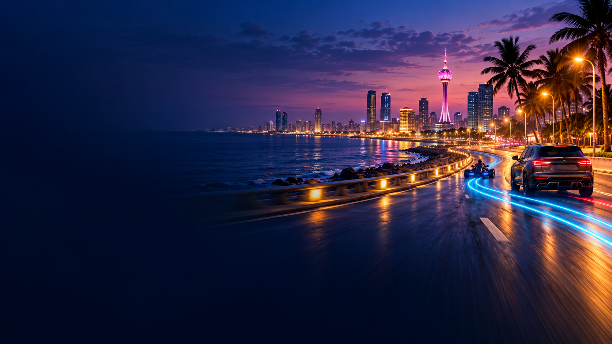<br><sub>Night loading artwork.</sub></td>
  </tr>
</table>

<p>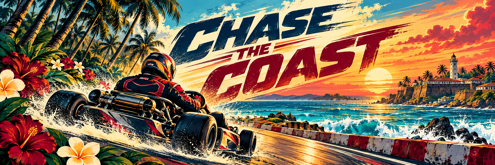</p>
<p>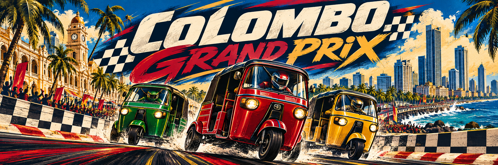</p>
<p>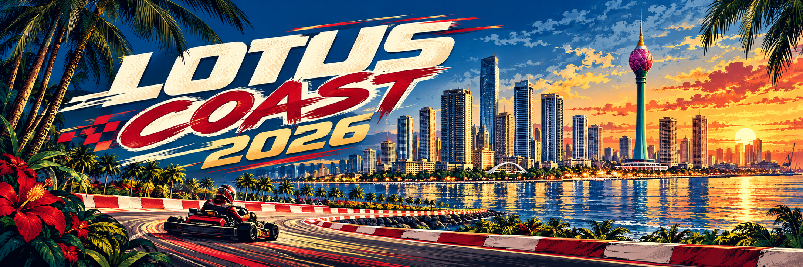</p>

<table>
  <tr>
    <td width="25%">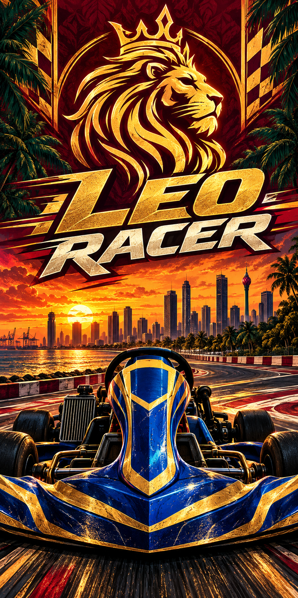</td>
    <td width="25%">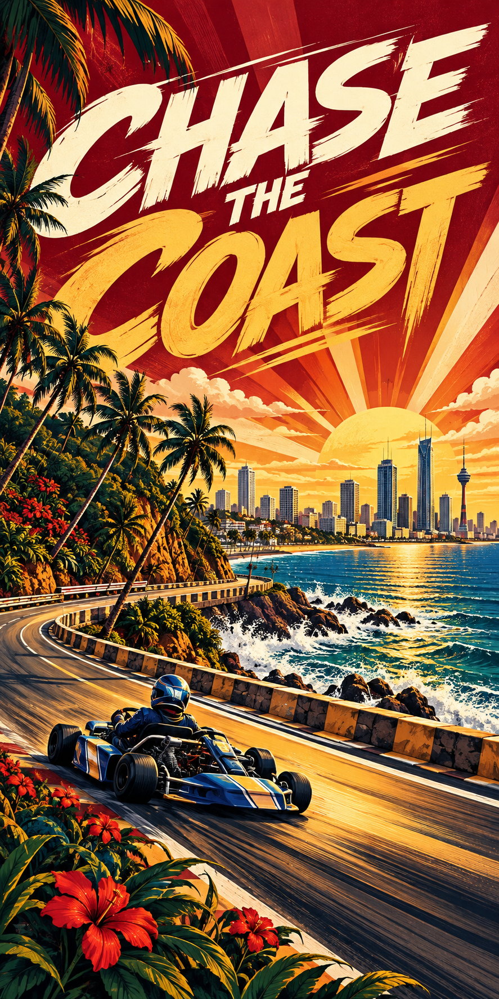</td>
    <td width="25%">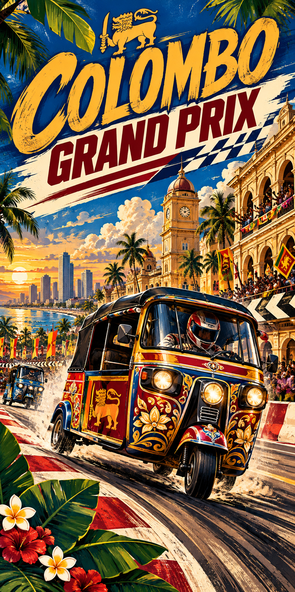</td>
    <td width="25%">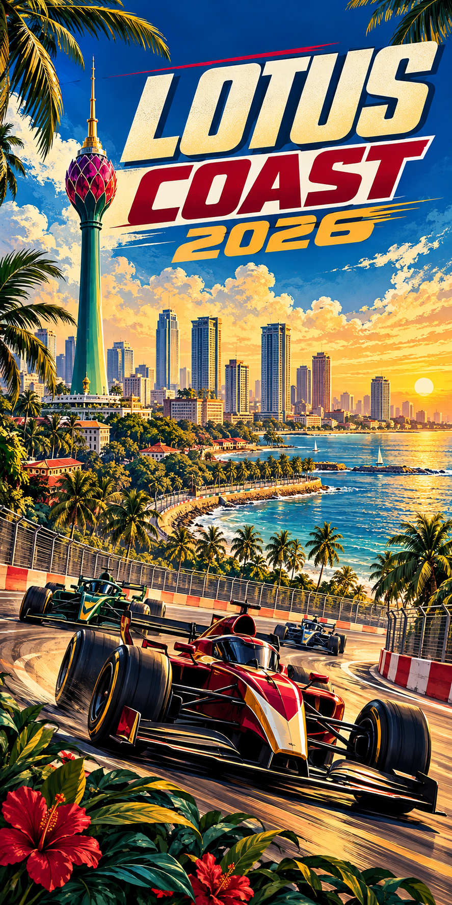</td>
  </tr>
</table>

<p align="center">
  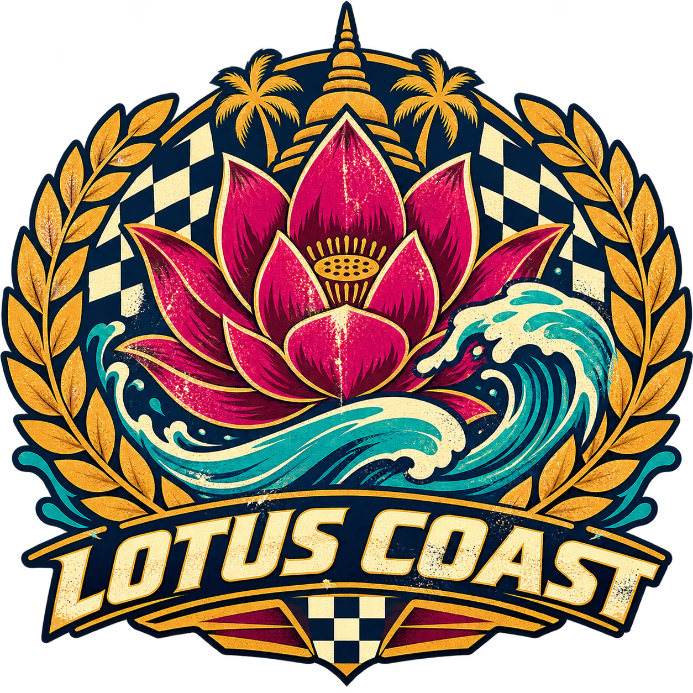
  &nbsp; &nbsp;
  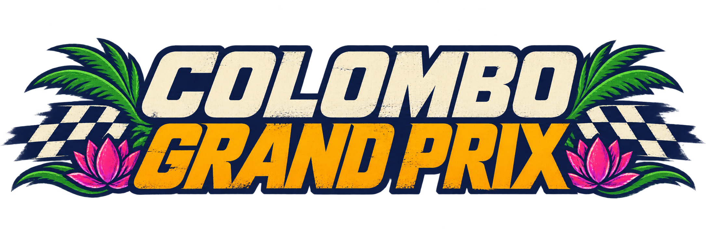
</p>

[Artwork and audio provenance](licenses/ASTRA_ASSETS.md) · [Sri Lankan asset notices](licenses/SRILANKA_ASSETS.md)

</details>

## Build &amp; create

<details>
<summary><strong>Developer setup, content tools &amp; the track SDK</strong></summary>

The released game uses **Godot 4.7.2 .NET**, GDScript gameplay, and C# presentation/SQLite bridges. Source for the published release is tagged **v2.3.2**; the camera and vehicle feature work is on **orbitcamera**.

Start with [setup and pinned dependencies](docs/COLOMBO_SETUP.md). With the required original asset archives, run:

```powershell
& ".\Setup Colombo.cmd" -AssetArchives "C:\assets\AI"
& ".\Open Colombo in Godot.cmd"
```

Build compatible content independently:

```powershell
./tools/check_modularity.ps1 -Integration
./tools/build_content.ps1 -Target vehicle -Id duster
./tools/build_content.ps1 -Target track -Id community_example
./tools/build_content.ps1 -Target sdk
```

Vehicle and track targets do not export a new executable. See the [SDK requirements](sdk/README.md) before importing third-party models.

[Release build and selectable installer](docs/RELEASE_232.md) · [Art pipeline](docs/COLOMBO_ASSETS.md) · [Supplied model setup](docs/SRILANKA_SETUP.md) · [Astra circuit pipeline](docs/ASTRA_SETUP.md)

</details>

<details>
<summary><strong>What's new, release history &amp; verification</strong></summary>

| Release | Highlights |
|---|---|
| **2.3.2** | Reverse/orbit cameras, remappable lights and actions, Bigster sunroof and corrected optical groups, Workshop feature authoring, complete/custom installer. |
| **2.3.1** | Kandy scenery, physical signage and start arch, grounded landmarks, mountain depth, daylight environment, and loading-text fixes. |
| **2.2.0** | Loose vehicle packages, in-game Workshop, and contributor track SDK. |
| **2.1.0** | Expanded Colombo districts, coherent buildings, shoreline, lake shores, and tropical daylight. |
| **2.0.0** | Neon frontend, driver carousel, animated vehicle statistics, procedural UI audio, and day/night loading art. |

The 2.3.2 evidence includes 53 focused vehicle/camera/input checks, 69 packaged camera checks per renderer, six three-lap race runs, validation of all 48 cars, and SDK-free startup/content checks. Complete, Standard, Custom, upgrades, destination guards, backups, and uninstall preservation were tested.

[Release notes](docs/RELEASE_NOTES_232.md) · [Vehicle verification](docs/qa-vehicle232/TEST_REPORT.md) · [Installer results](docs/qa-vehicle232/release-installer.json) · [Kandy implementation](docs/KANDY_231.md) · [Neon UI](docs/NEON_UI.md)

</details>

<details>
<summary><strong>Credits, licenses &amp; attribution</strong></summary>

Kenney's Racing Starter Kit and City Kit remain the foundation. The project also uses Rokojori, Terrain3D, EZ Tree, Quaternius CC0 foliage, AmbientCG PBR maps, and the components credited in the source tree. Their individual licenses and notices apply; the repository does not place all third-party assets under one blanket license.

Rokojori source is obtained separately under its Public Indie License and is not republished as a standalone toolkit. Existing character and vehicle meshes retain their original notices. Leo Racer is an independent project.

[Licenses](licenses/) · [Astra artwork and audio](licenses/ASTRA_ASSETS.md) · [Sri Lankan assets](licenses/SRILANKA_ASSETS.md) · [Kandy attribution](licenses/Kandy-2.3.1.txt)

</details>

<hr>

<p align="center">
  <strong>Pick your ride. Find your line. One more lap.</strong><br><br>
  <a href="https://github.com/amilapcsgit/Leo_Racer/releases/latest/download/LeoRacer-Setup.exe">Download Leo Racer</a>
  &nbsp; · &nbsp;
  <a href="https://github.com/amilapcsgit/Leo_Racer/releases/latest">Release notes &amp; checksums</a>
  &nbsp; · &nbsp;
  <a href="#leo-racer">Back to the grid ↑</a>
</p>
