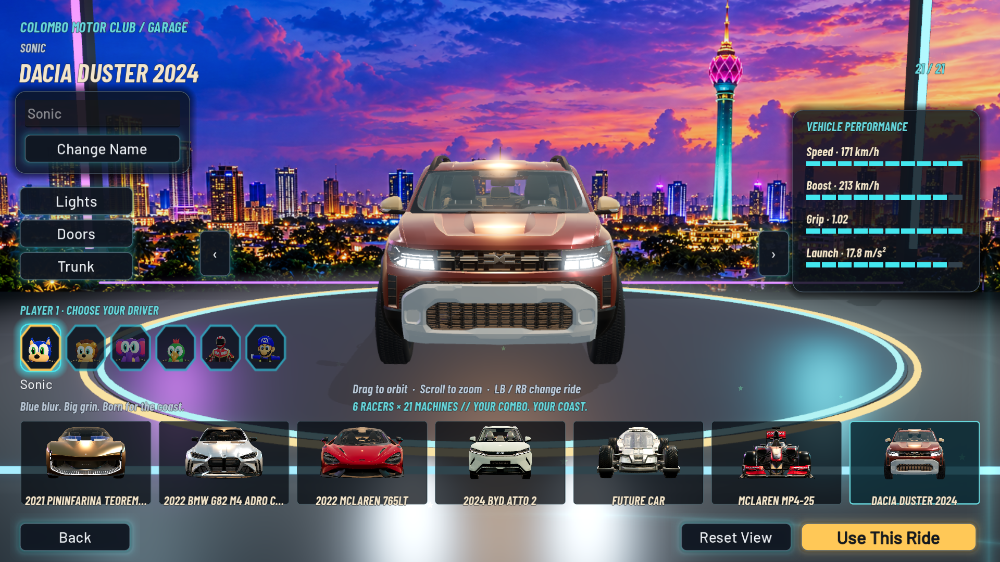
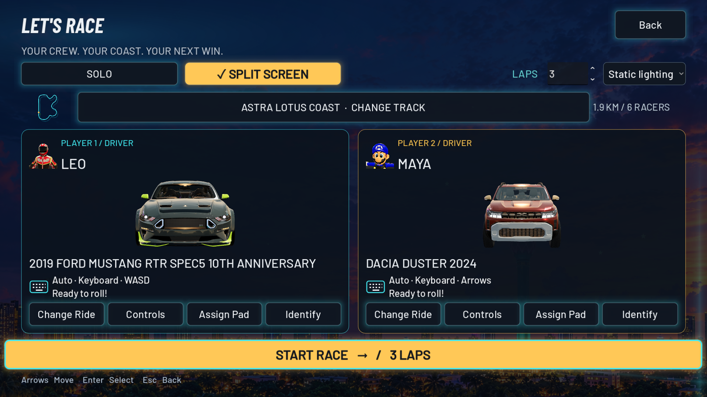
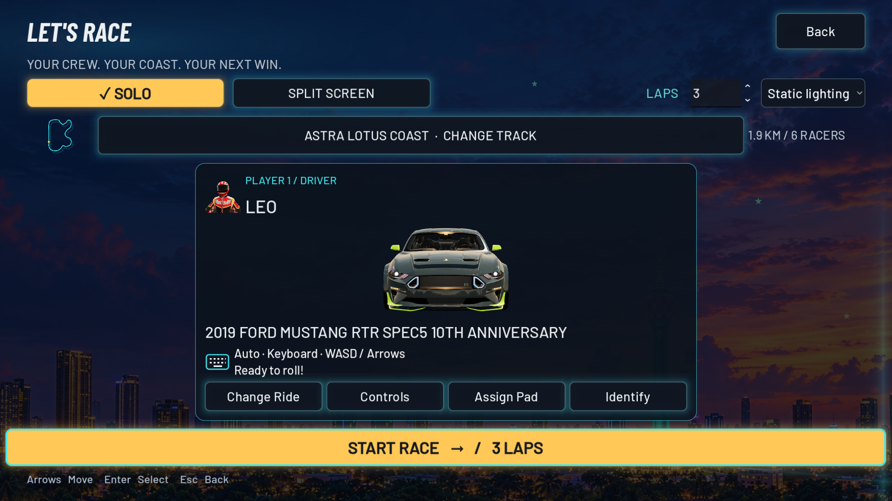
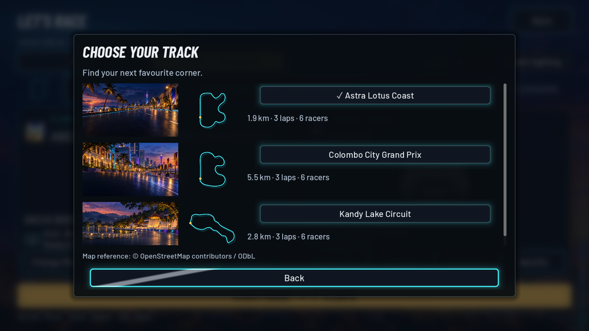
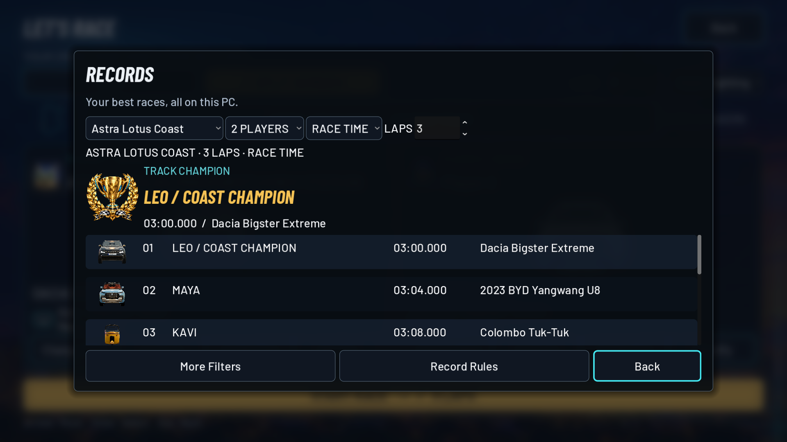
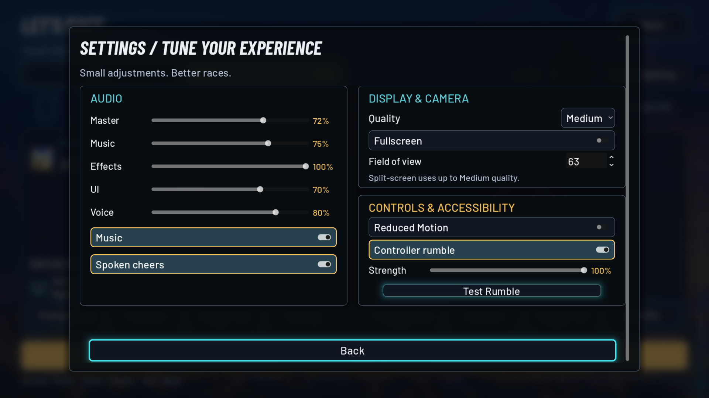
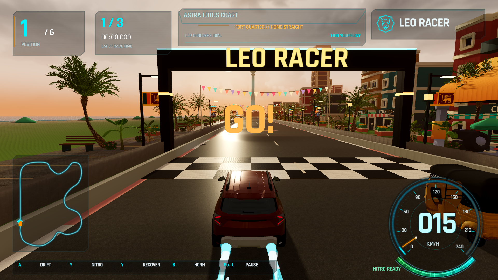

<h1 align="center">Leo Racer · 2.7 Ultra</h1>

<strong>Your ride. Your coast. Your next best lap.</strong> A Windows arcade racer on stylized Sri Lankan roads.

   
  <a href="https://github.com/amilapcsgit/Leo_Racer/releases/latest">Release notes, portable ZIP &amp; SHA256 checksums</a>

**21 cars · 6 drivers · 3 tracks · 1–2 local players · 1–10 laps**

Race five AI rivals, or share the screen with someone next to you. Charge a drift, catch a slipstream, and spend your nitro on the next straight. Choose your driver and car in the illuminated showroom, then chase your best time. Play offline: no account or developer tools required.

## Download and play

1. Download **LeoRacer-Setup.exe** using the button above, from this repository’s GitHub release.
2. Run the installer and keep the complete content selection for all 21 cars and three tracks.
3. Launch **Leo Racer** from its shortcut. Choose **Let’s Race**, your ride, and **Start Race**.

Windows 64-bit. Use the included **Play Compatibility.cmd** if Vulkan is unavailable. Prefer a dedicated GPU; lower quality or use Compatibility on older hardware. Keep the entire portable folder together if using the ZIP. Existing selections, custom content and historical records are preserved by the supported upgrade path; modified managed files receive backups.

Downloads are hosted on GitHub over HTTPS. Compare the installer against **SHA256SUMS.txt** on the release page if desired. Windows may display an unfamiliar-publisher warning; this project makes no claim of a trusted code-signing certificate. Download only from this repository’s releases.

## What’s new in Ultra

- Transparent previews for every car, instant garage placeholders, a quick dissolve into the live 3D model, and automatic showroom rotation.
- Car-focused race setup, clearer player/controller identities, a lap selector, and lighting choices.
- Scrollable track selection with all three route outlines, an animated winners’ leaderboard, and compact grouped settings.
- Configurable gamepad rumble, Identify controls, and the configured **boost button also works as OK in menus**.
- Bigster **Sunroof / Trunk** actions and visible Duster 2024 boost jets.
- Updated arcade suspension and collision feedback, compatible lap-specific records, and retained custom-car imports.

## Take a look

These are real captures of the game. Leaderboard screenshots use isolated demonstration records.

| Ready to race | Solo setup |
|---|---|
|  |  |
| **Track selection** | **Records** |
|  |  |
| **Settings** | **On the road** |
|  |  |

## Three places to race

| Circuit | Character | Length |
|---|---|---|
| Astra Lotus Coast | Oceanfront straights and neon coastal corners | 1.9 km |
| Colombo City Grand Prix | A longer city circuit through Colombo | 5.5 km |
| Kandy Lake Circuit | Lakeside corners in Sri Lanka’s hill country | 2.8 km |

Choose **1–10 laps**, default **3**, and a lighting preset including dusk-to-night progression. Race records keep lap counts and driving rulesets separate; older times remain available through historical filters.

## Controls

| Action | Keyboard defaults | Xbox-style controller defaults |
|---|---|---|
| Drive | WASD / arrows | Left stick; RT accelerate, LT brake |
| Drift | Space | A |
| Nitro / boost | Shift | X |
| Menu OK / Confirm | Enter | **Your configured boost button (X by default)**; A also supported |
| Menu Back | Esc | B |
| Recover | R | Y |
| Pause | Esc / P | Start |
| Horn | H | B |
| Vehicle actions | O / K (remappable) | D-pad Up / Down |

The Controls screen shows the actual bindings for each player, including shared-keyboard presets. Garage: **LB / RB** changes cars; drag to orbit and scroll to zoom with a mouse. Bigster Action 1 opens its sunroof; Action 2 opens its trunk. Assign identical pads with **Press A to assign**, then use **Identify** to distinguish them. Rumble strength and a test control are in Settings.

## Create and share

The included **Vehicle Workshop** supports custom imports. Use **Vehicle Workshop.cmd** in the game folder, or open the in-game content tools. The game generates matching transparent previews for future imports.

For a showcase website or social post, download **LeoRacer-2.7.0-Media-Pack.zip** from the [latest release](https://github.com/amilapcsgit/Leo_Racer/releases/latest). It includes transparent cars, artwork, vectors, track outlines, real screenshots and attribution guidance. Promotional illustrations are labeled as artwork rather than gameplay.

## Feedback and known limits

Friends and family: please [send feedback or report a problem](https://github.com/amilapcsgit/Leo_Racer/issues/new). Include your Windows version, GPU, selected renderer, track, player count and what happened. A screenshot helps.

This release prioritizes the finished UI and playable arcade experience. Further physics tuning is deferred. Short cold-preview stalls remain; Kandy split-screen narrowly misses the 60 FPS frame-time target in some Compatibility tests. Physical two-controller reconnect/rumble feel has not been verified because controllers were unavailable. See the [measured validation report](docs/VALIDATION_270.md) and [release notes](docs/RELEASE_NOTES_270.md).

## Build and contribute

The 2.7 game source is on [2.7-ultra](https://github.com/amilapcsgit/Leo_Racer/tree/2.7-ultra). Check out that branch before building.

Godot **4.7.2 .NET**, with pinned tools and reproducible published content. See [setup instructions](docs/COLOMBO_SETUP.md). The shared Windows validation/package entrypoint is `tools/ultra_windows.ps1 -Package`; it stages content before gameplay tests and produces the installer, portable archive and diagnostics. Synced project sources and original model assets are preserved.

<strong>Credits, licenses &amp; attribution</strong>

Kenney's Racing Starter Kit and City Kit remain the foundation. The project also uses Rokojori, Terrain3D, EZ Tree, Quaternius CC0 foliage, AmbientCG PBR maps, and the components credited in the source tree. Their individual licenses and notices apply; the repository does not place all third-party assets under one blanket license.

Rokojori source is obtained separately under its Public Indie License and is not republished as a standalone toolkit. Existing character and vehicle meshes retain their original notices. Leo Racer is an independent project.

[Licenses](https://github.com/amilapcsgit/Leo_Racer/blob/v2.4.1/licenses/) · [Astra artwork and audio](https://github.com/amilapcsgit/Leo_Racer/blob/v2.4.1/licenses/ASTRA_ASSETS.md) · [Sri Lankan assets](https://github.com/amilapcsgit/Leo_Racer/blob/v2.4.1/licenses/SRILANKA_ASSETS.md) · [Kandy attribution](https://github.com/amilapcsgit/Leo_Racer/blob/v2.4.1/licenses/Kandy-2.3.1.txt)

  <strong>Pick your ride. Find your line. One more lap.</strong>  
  <a href="https://github.com/amilapcsgit/Leo_Racer/releases/latest/download/LeoRacer-Setup.exe">Download Leo Racer</a>
  &nbsp; · &nbsp;
  <a href="https://github.com/amilapcsgit/Leo_Racer/releases/latest">Release notes &amp; checksums</a>
  &nbsp; · &nbsp;
  <a href="#leo-racer">Back to the grid ↑</a>

