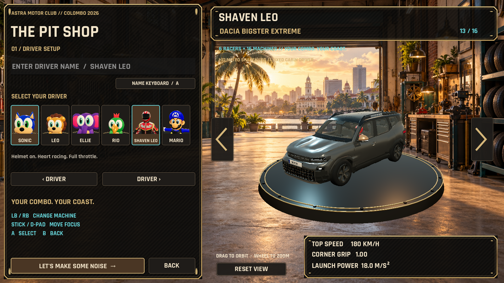

# Leo Racer — Colombo 2026

**Version 2.0.0** introduces a cinematic street-racing menu, **Go Race → Race Setup → Start Race**, automatic controller assignment, and two players sharing one keyboard. Generated Colombo artwork, a unified garage and compact HUD, playful sound cues, and offline English cheers make racing easier to start. See [controls, validation, and known limitations](docs/UI_REFRESH.md).

A local Windows arcade racer with six drivers, sixteen vehicles, the 1.9 km **Astra Lotus Coast** and 5.5 km **Colombo City Grand Prix**. Both tracks support single player and vertical two-player split screen. Existing settings, vehicles, race rules, and offline rankings are retained.

**New in 2.0:** a dimensional driver carousel, reactive neon buttons, animated car statistics, procedural sound cues, and alternating day/night loading artwork. See [implementation and validation](docs/NEON_UI.md).

## Play

Download **LeoRacer-Setup-2.0.0.exe** to install, or extract the entire **LeoRacer-2.0.0-win64.zip** folder and run **LeoRacer.exe**. Keep the complete folder together. Godot, a .NET installation, and an internet connection are not required to play. [Downloads and checksums](https://github.com/amilapcsgit/Leo_Racer/releases/tag/v2.0.0).

Use **Play Compatibility.cmd** if Vulkan is unavailable. Compatibility mode uses simpler effects. Previous releases remain available for rollback.

| Action | Keyboard | Controller |
| --- | --- | --- |
| Accelerate / brake / reverse | W / S or arrows | Triggers |
| Steer | A / D or arrows | Left stick |
| Drift | Space | A |
| Nitro | Shift | X |
| Recover | R | Y |
| Horn | H | B |
| Pause | Esc or P | Start |
| Hide HUD for photos | F8 | — |

Choose **Go Race → 2 Players → Start Race** for P1 left / P2 right, two humans and four AI. Single-player retains five AI opponents. Both modes use three laps. Each human chooses a name, driver, vehicle and input device; the second human continues when the first finishes. Tap accelerate on the final countdown beat for a launch boost. Recharge nitro through drifting and by slipstreaming behind another moving racer. Hold drift through steering corrections, then release a charged drift for a mini-turbo; longer charges earn SUPER DRIFT. Eight boost pads reward a flowing racing line. Recovery preserves ordered checkpoints, and a kart stuck under throttle resets safely after three seconds. Six identities and sixteen vehicles share the catalog; both Dacias display the selected driver in a cabin-specific pose. Pause → Change Car retains race progress; changed races cannot set records.

**Reduced Motion** in Settings disables camera kicks, roll, shake, and recovery distortion while retaining useful visual feedback. Existing preferences are preserved. Named SQLite race/lap records are filtered by mode, performance class and optional vehicle. Old 1.6 bests are shown separately; DNF and modified races cannot enter new rankings.

Race Setup → **Controls** saves per-player remapping and calibration for keyboard, Xbox-style controllers and raw joystick/wheel axes. Two players can share one keyboard using complementary WASD/arrow presets; each pad or wheel belongs to one human. Auto chooses the first available mapped controller, then keyboard. Identical controllers require owner confirmation. An assigned-device disconnect pauses both players until reassignment or retirement.

Standard vehicles and Duster: **165/198 km/h**; Bigster: **180/225 km/h**. Common acceleration **18 m/s²**, handling **1.0**. Bigster retains 130% game scale, corrected tire centers, electric boost and regeneration. Logitech Formula Force EX physical compatibility is unverified; wheel force feedback is not included.

## Develop

This is a **Godot 4.7.2 .NET** project using **GDScript gameplay** and C# presentation and offline SQLite bridges. Run `Setup Colombo.cmd -AssetArchives "C:\assets\AI"` with the original addon archives, then `Open Colombo in Godot.cmd`. Setup instructions and pinned dependency details are in [COLOMBO_SETUP.md](docs/COLOMBO_SETUP.md).

- [Astra build, model and circuit pipeline](docs/ASTRA_SETUP.md)
- [Art pipeline and asset provenance](docs/COLOMBO_ASSETS.md)
- [1.7 multiplayer validation and performance](docs/LOCAL2PLAYER_VALIDATION.md)
- [2.0 release notes](docs/RELEASE_NOTES.md)
- [Earlier Astra validation](docs/ASTRA_VALIDATION.md)
- [Supplied-asset conversion and setup](docs/SRILANKA_SETUP.md)
- [Visual comparison](docs/ASTRA_COMPARISON.md)
- [Rendered captures](docs/qa-astra/captures/capture-manifest.json)
- [Editable art profile](assets/config/astra.tres)
- [Blender conversion pipeline](blender/import_srilanka.py)

All 34 original model GLBs and the previous circuit remain in the repository. Astra uses a new route dataset and a separate decorative world builder, with flat road collision and continuous protective boundaries. Vehicle wheel animation and ordered checkpoint rules remain shared. Original Blender sources and metadata accompany the new vehicles.

## Dependencies and notices

Kenney's Racing Starter Kit and City Kit remain the foundation. Additions use Rokojori v0.6, Terrain3D v1.0.2, EZ Tree, Quaternius Standard CC0 foliage, and AmbientCG CC0 PBR maps. Third-party components retain their own licenses; see `licenses/` and the addon notices. Rokojori source is obtained separately under its Public Indie License and is not republished as a standalone toolkit.

Sonic-inspired and other character/kart meshes are the existing stylized Blender models. This is an independent project.

Astra original artwork and audio notices: [ASTRA_ASSETS.md](licenses/ASTRA_ASSETS.md). Road-paint generation prompts: `assets/art/astra/prompts.json`.
