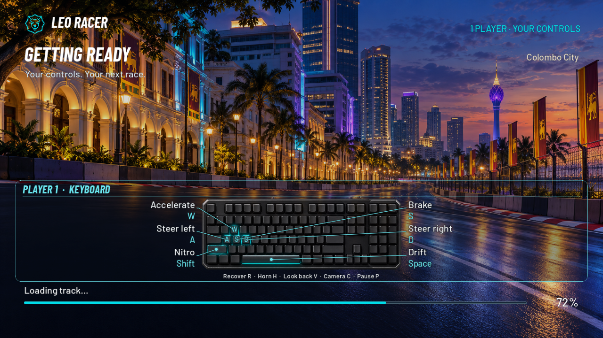
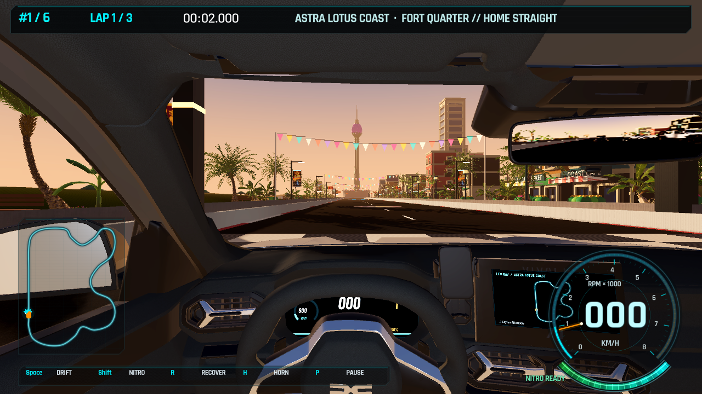
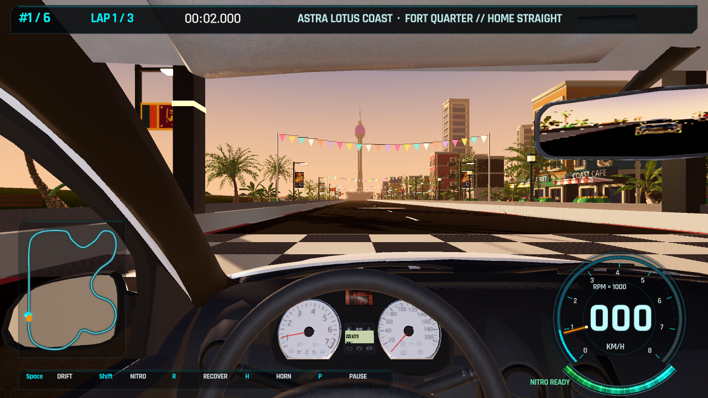
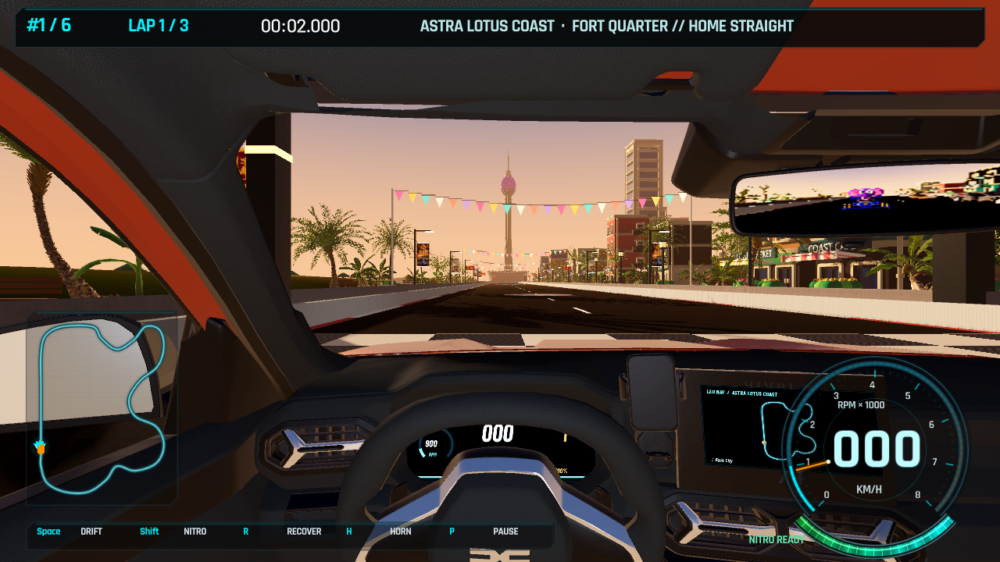
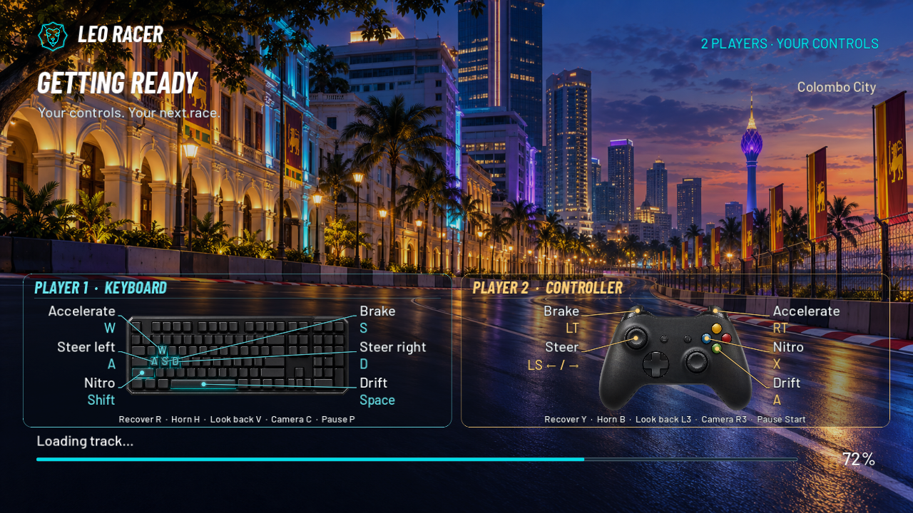
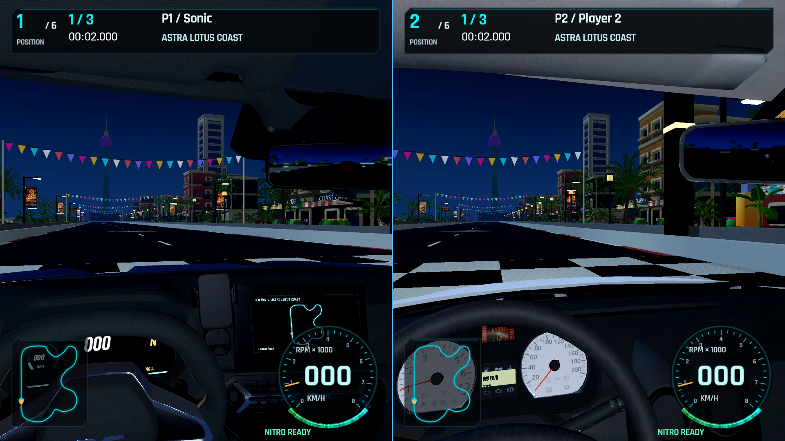
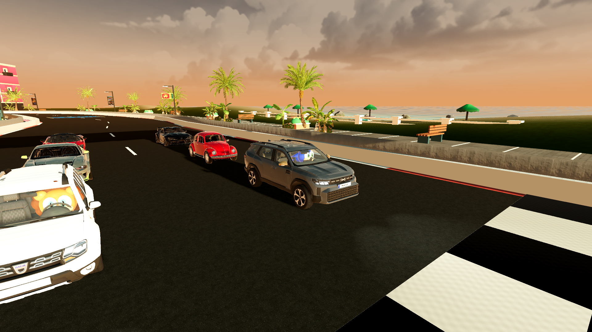
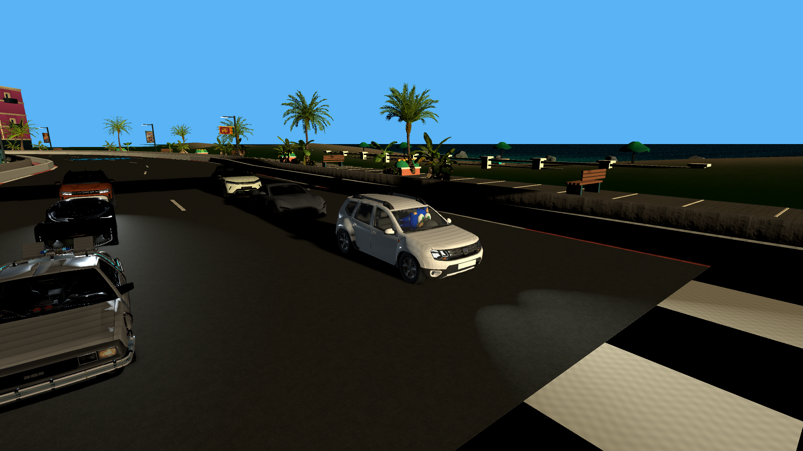

<h1 align="center">Leo Racer · 2.7.9</h1>

<strong>Your ride. Your coast. Your next best lap.</strong> A Windows arcade racer on stylized Sri Lankan roads.

   
  <a href="https://github.com/amilapcsgit/Leo_Racer/releases/latest">Release notes, portable ZIP &amp; SHA256 checksums</a>

*Actual solo loading interface over illustrated Colombo City gallery artwork.*

**21 cars · 6 drivers · 3 tracks · 1–2 local players · 1–10 laps · Offline play**

Race five AI rivals, or share the screen with someone next to you. Charge a drift, catch a slipstream, and spend your nitro on the next straight. Pick a driver and car in the showroom, find your line, and chase your personal best. No account or developer tools are required to play.

## A closer seat to the action

The **Bigster, Duster My 2014 and Duster 2024** now have reviewed driver-seat cockpits. Steering wheels turn as complete assemblies with space around the dashboard. Live instruments and navigation displays bring the cabin to life; the 2014 keeps its analog cluster and adds a fitted navigation/media screen.

Your familiar **analog RPM dial and digital km/h HUD** keep their design and position in Chase, Ghost and Cockpit, for each local player. A shallow cockpit header keeps position, lap and time readable while opening the forward view. Visible mirrors use a **30 Hz refresh target** for smoother traffic feedback.

| Bigster | Duster My 2014 | Duster 2024 |
|---|---|---|
|  |  |  |

*Actual in-engine cockpit captures. Open an image for the full view.*

## Ready together

Graphical keyboard, controller and wheel guides show each player's saved bindings while a race loads. Solo and split-screen share the same clear player identities, device assignment and remapping tools. Calmer focus effects and clearer results cards keep the next action easy to find.

| Two-player loading controls | Two-player cockpit race at night |
|---|---|
|  |  |

*Left: runtime controls over illustrated loading artwork. Right: actual in-engine split-screen cockpit view on Astra Lotus Coast at night, with each player's analog RPM and digital km/h HUD. Open the race image for its full view.*

Settings now has five tabs: **Graphics, Audio, Controls, Accessibility and Game Logic**. In **Game Logic**, “Allow Bigster as an AI opponent” starts **off**. Switch it on for your next new race or restart; Bigster remains available to human players throughout.

## Sri Lanka, from coast to hill country

More consistent dry asphalt, restrained surface reflections and additional roadside planting enrich the existing circuits. The shared **23-image loading gallery** includes five new location heroes: **Galle Fort, Hikkaduwa, Nine Arch Bridge, Sigiriya and Sri Dalada Maligawa**. A shuffle bag varies the artwork between loads and keeps one image steady throughout each operation.

| Circuit | Character | Length |
|---|---|---|
| Astra Lotus Coast | Oceanfront straights and coastal corners | 1.9 km |
| Colombo City Grand Prix | A longer city circuit through Colombo | 5.5 km |
| Kandy Lake Circuit | Lakeside corners in Sri Lanka’s hill country | 2.8 km |

Choose **1–10 laps**, default **3**, and a lighting preset including dusk-to-night progression. Records keep lap counts and driving rulesets separate; historical filters retain access to older times.

| Bigster on the coast | Duster My 2014 on the coast |
|---|---|
|  |  |

*Actual in-engine coastal views, captured with a preset camera and the HUD hidden. Original vehicle and track source assets are preserved.*

## A soundtrack for the whole drive

Two custom intro tracks accompany boot, loading, menus and the garage without restarting at every screen change. Kandy and the coastal circuits have their own race openers, followed by a varied **six-track pool**: four user-supplied custom tracks, **Ceylon Afterglow**, and the original **Island Music**. Smooth transitions keep the music moving between the garage and the race. Everything is bundled for offline play.

The custom recordings retain their [source credits and provenance](licenses/customaudio279.md). See the [2.7.9 release notes](docs/RELEASE_NOTES_279.md), [cockpit details](docs/COCKPITS_279.md) and [measured validation](docs/VALIDATION_279.md) for the changes and current limits.

## Download and play

1. Download **LeoRacer-Setup.exe** using the button above, from this repository’s GitHub release.
2. Keep the complete content selection for all **21 cars and three tracks**.
3. Launch **Leo Racer** from its shortcut. Choose **Let’s Race**, your ride, and **Start Race**.

Windows 64-bit. Use the included **Play Compatibility.cmd** if Vulkan is unavailable. Prefer a dedicated GPU; lower quality or use Compatibility on older hardware. Keep the entire portable folder together if using the ZIP. The supported upgrade path preserves selections, custom content and historical records, and backs up modified managed files.

Downloads are hosted on GitHub over HTTPS. Compare the installer against **SHA256SUMS.txt** on the release page if desired. Windows may display an unfamiliar-publisher warning; the project makes no claim of a trusted code-signing certificate. Download from this repository’s releases.

## Controls

| Action | Keyboard defaults | Xbox-style controller defaults |
|---|---|---|
| Drive | WASD / arrows | Left stick; RT accelerate, LT brake |
| Drift | Space | A |
| Nitro / boost | Shift | X |
| Menu OK / Confirm | Enter | **Configured boost button (X by default)**; A also supported |
| Menu Back | Esc | B |
| Recover | R | Y |
| Pause | Esc / P | Start |
| Horn | H | B |
| Change camera | C | Right-stick click |
| Look back | V | Left-stick click |
| Vehicle actions | O / K, remappable | D-pad Up / Down |

The Controls screen shows the actual bindings for each player, including shared-keyboard presets. Garage: **LB / RB** changes cars; drag to orbit and scroll to zoom with a mouse. Bigster Action 1 opens its sunroof; Action 2 opens its trunk. Assign identical pads with **Press A to assign**, then use **Identify** to distinguish them. Rumble strength and its test control are in Settings.

## Create, play and share a link

The included **Vehicle Workshop** supports custom imports and matching transparent previews. Use **Vehicle Workshop.cmd** in the game folder, or open the in-game content tools.

The [2.7.1 artwork release](https://github.com/amilapcsgit/Leo_Racer/releases/tag/v2.7.1) includes **LeoRacer-2.7.1-Media-Pack.zip** with transparent cars, vectors, track outlines, artwork, screenshots and attribution guidance. Its individual terms apply. Promotional illustrations are labeled as artwork.

## Credits and license

**Author: L.J. Amila Prasad Perera.** I made Leo Racer for my son, **Shaven Leo**, who is six years old.

Leo Racer is an independent indie project. Third-party trademarks, names, logos and characters belong to their respective owners; their inclusion does not imply affiliation or endorsement. See [licenses](licenses/) for the creators and terms of third-party materials.

Original work is offered under the [custom non-commercial license](LICENSE) where the author holds the necessary rights. Earlier AGPL and MIT permissions remain in effect for material previously supplied under those terms. Third-party licenses continue to apply. Share the official download link; redistribution and commercial use require the permissions described in those terms.

<strong>Credits, licenses &amp; attribution</strong>

Kenney's Racing Starter Kit and City Kit remain the foundation. The project also uses Rokojori, Terrain3D, EZ Tree, Quaternius CC0 foliage, AmbientCG PBR maps, and the components credited in the source tree. Their individual licenses and notices apply; the repository does not place all third-party assets under one blanket license.

Rokojori source is obtained separately under its Public Indie License and is not republished as a standalone toolkit. Existing character and vehicle meshes retain their original notices.

[Licenses](licenses/) · [Astra artwork and audio](licenses/ASTRA_ASSETS.md) · [Sri Lankan assets](licenses/SRILANKA_ASSETS.md) · [Kandy attribution](licenses/Kandy-2.3.1.txt) · [Custom soundtrack](licenses/customaudio279.md)

## Feedback, performance and building

Friends and family: please [send feedback or report a problem](https://github.com/amilapcsgit/Leo_Racer/issues/new). Include your Windows version, GPU, renderer, track, player count and what happened. A screenshot helps.

Performance varies with track, renderer and player count. Compatibility remains available, and split-screen caps scenery at Medium. Physical controller/wheel, rumble, reconnect and display checks are described in the [validation report](docs/VALIDATION_279.md); screenshots do not establish those hardware results.

Build with Godot **4.7.2 .NET** and the pinned tools. See [setup instructions](docs/COLOMBO_SETUP.md). The shared Windows entrypoint is `tools/ultra_windows.ps1 -Package`; it stages content and produces the installer, portable archive and diagnostics. Synced project sources and original model assets remain preserved.

  <strong>Pick your ride. Find your line. One more lap.</strong>  
  <a href="https://github.com/amilapcsgit/Leo_Racer/releases/latest/download/LeoRacer-Setup.exe">Download Leo Racer</a>
  &nbsp; · &nbsp;
  <a href="https://github.com/amilapcsgit/Leo_Racer/releases/latest">Release notes &amp; checksums</a>

