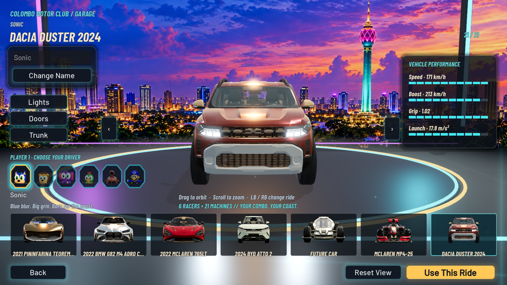
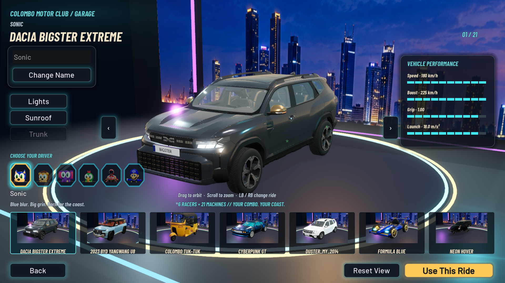
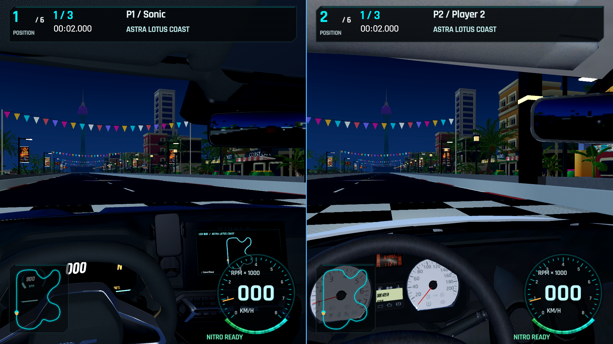
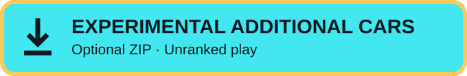
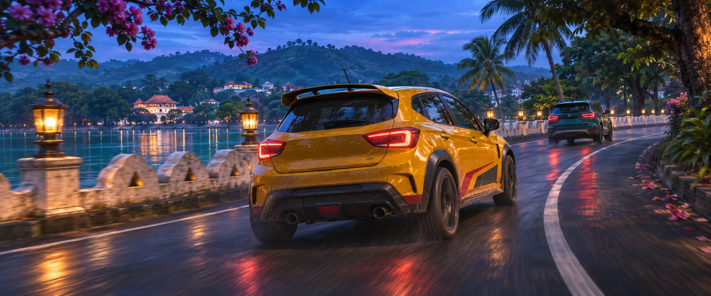

# Leo Racer

**A 3D arcade racer on Sri Lankan roads, built in Godot for Windows. Pick a car in the live showroom, race solo against AI, or share the screen with a second player.**

 · [Portable ZIP](https://github.com/amilapcsgit/Leo_Racer/releases/download/v2.8.1/LeoRacer-2.8.1-win64.zip) · [Official website](https://leoracer.amilaperera.it/)

*The live 3D garage, captured in-engine in 2.7.0.*

**21 cars · 6 drivers · 4 Sri Lankan circuits · 1–2 local players · 1–10 laps · Offline play**

I started Leo Racer for my son, **Shaven Leo**, and have spent months building, tuning and playtesting it.

[The garage](#the-3d-garage) · [Circuits](#circuits) · [Play on Windows](#play-on-windows) · [Controls](#controls) · [Creator tools](#creator-tools) · [How I built it](#how-i-built-it)

## The 3D garage

Orbit and zoom around a live 3D model, compare speed, grip and launch stats, and choose a driver before heading to the grid. Cars have their own wheel setups, materials and handling. In split-screen, each player picks their own driver and car.

| 3D showroom in Forward+ | Split-screen cockpit race |
|---|---|
|  |  |

*Both images are in-engine captures from development builds. More [cockpit and loading-screen captures](docs/screenshots/2.7.9/README.md) are in the gallery.*

Drift to build charge, find a slipstream, and spend nitro on the next straight. Switch between Chase, Ghost and Cockpit. The Bigster, Duster My 2014 and Duster 2024 have detailed cockpits with working instruments and mirrors. Each player has their own camera, HUD and controls. The game keeps personal records locally and bundles its engine audio and soundtrack for offline play.

## Circuits

| Circuit | What to expect |
|---|---|
| **Astra Lotus Coast** | Oceanfront straights and sweeping coastal corners |
| **Colombo City Grand Prix** | A longer street circuit through Colombo |
| **Kandy Lake Circuit** | Lakeside corners in Sri Lanka's hill country |
| **Wennappuwa Street Circuit** | Unranked street racing in solo and local split-screen |

Choose 1–10 laps and static lighting or **Dusk to Night**. In 2.8.1, Easy, Assisted and Standard handling presets offer different speeds and steering response. Records in 2.8.1 also account for the handling preset.

## Play on Windows

| Download | What you get |
|---|---|
| [**Windows installer**](https://github.com/amilapcsgit/Leo_Racer/releases/download/v2.8.1/LeoRacer-Setup.exe) | Stable 2.8.1, with shortcuts, 21 cars and all four circuits |
| [**Portable ZIP**](https://github.com/amilapcsgit/Leo_Racer/releases/download/v2.8.1/LeoRacer-2.8.1-win64.zip) | The same stable game in a folder you can extract and run |

The Windows x64 builds include their runtime. You can install and play offline without a separate Godot or .NET SDK installation. Download verification and release notes are on the [stable release page](https://github.com/amilapcsgit/Leo_Racer/releases/tag/v2.8.1).

New profiles start on Astra Lotus Coast with Bigster, three laps, Assisted handling, and Reduced Motion enabled.

1. Run the installer and launch **Leo Racer** from its shortcut. For the portable build, extract the whole archive and run `LeoRacer.exe`.
2. If Forward+ gives you graphics problems or Vulkan is unavailable, run `Play Compatibility.cmd` from the game folder.
3. Select **Go Race**, choose **SOLO** or **SPLIT SCREEN**, pick your circuit and car, then select **START RACE**.

### Bonus cars to experiment with

Extract the ZIP and follow its installation guide. These cars are optional and use unranked play.

## Controls

Two local players can share a keyboard, use separate controllers, or mix input devices. To claim a controller, choose **Assign Pad** on the player card and press **A** on that controller. **Identify** helps distinguish identical pads. **Controls** lets you change bindings, and the race loading screen shows the saved bindings for each active player.

| Action | Keyboard defaults | Xbox-style defaults |
|---|---|---|
| Steer | A / D or Left / Right | Left stick |
| Accelerate / brake | W / S or Up / Down | RT / LT |
| Drift / nitro | Space / Shift | A / X |
| Recover / pause | R / Esc or P | Y / Start |
| Horn | H | B |
| Change camera / look back | C / V | Right-stick click / left-stick click |
| Headlights | L | D-pad Left |
| Vehicle actions | O / K | D-pad Up / Down |
| Menu confirm / back | Enter / Esc | A or configured boost button / B |

## Creator tools

| Tool | What it does |
|---|---|
| **Vehicle Workshop** | Import your own GLB, normalize its scale and orientation, set wheel pivots and separate brake calipers, then take it for a private test drive. Export a standalone vehicle folder with its thumbnail and metadata. The workshop runs offline from `Vehicle Workshop.cmd`. [Workshop guide](docs/VEHICLE_WORKSHOP.md) |
| **Offline Track Kit** | Bring in OpenStreetMap geography and elevation through Earth2Road, then edit the race line, grade and scenery in Godot. Validate and export a standalone track pack. The included Kandy example can be opened offline. [Track Kit guide](sdk/track-kit/README.md) |
| **Grass Field** | A Godot addon I built for the `2.8` branch. It uses batches of 3D grass blades, adjusts density and geometry with distance, and supports baked track data or a live Terrain3D provider. It can track two cameras for split-screen. [Addon and demo documentation](addons/grass_field/README.md) |

The Windows source build uses **Godot 4.7.2 .NET** and the pinned toolchain. The packaging entry point is `tools/ultra_windows.ps1 -Package`. [Development setup](docs/COLOMBO_SETUP.md) · [Content architecture](docs/MODULARITY.md) · [Media pack](https://github.com/amilapcsgit/Leo_Racer/releases/tag/v2.7.1)

## How I built it

I’m **L.J. Amila Prasad Perera**. Kenney's Racing Starter Kit gave me the starting point. I heavily reworked the handling and race flow, built out solo and split-screen play, and put together the 3D garage, Sri Lankan circuits, content tools and Windows packages.

I use AI as an assistant in parts of development and for some promotional illustrations. I make the design decisions, integrate the assets and systems, tune the driving and playtest the builds.

View the promotional illustrations

*AI-generated promotional illustrations inspired by Astra Lotus Coast and Kandy Lake Circuit.*

## Release notes and feedback

- **2.8.0** added adaptive grass and water, recorded vehicle audio, refreshed Kandy scenery and the fourth circuit at Wennappuwa. [Release notes](docs/RELEASE_NOTES_280.md) · [Validation](docs/VALIDATION_280.md)
- **2.8.1** adds track-matched Grass Field atlases and smaller, alternating boost pads. New profiles start on Astra Lotus Coast with Bigster, Assisted handling, three laps and Reduced Motion enabled. [Branch notes](docs/RELEASE_NOTES_281.md)
- **Bug reports** are most useful with the build, Windows version, GPU, renderer, track, player count and steps to reproduce. [Report a bug](https://github.com/amilapcsgit/Leo_Racer/issues/new) · [Follow 1080p testing](https://github.com/amilapcsgit/Leo_Racer/issues/8)

## Credits and license

Kenney's Racing Starter Kit and City Kit are credited alongside Rokojori, Terrain3D, EZ Tree, Quaternius foliage, AmbientCG maps, and other contributors. Map-derived data is credited to © OpenStreetMap contributors and retains its applicable terms. [Third-party notices](licenses/) · [Map data attribution](content/toolchain/earth2road/THIRD_PARTY_NOTICES.md) · [Vehicle audio credits](licenses/LeoRacer-280-Assets.md) · [Soundtrack credits](licenses/customaudio279.md)

Original work is offered under the [custom non-commercial license](LICENSE) where the author holds the necessary rights. Earlier AGPL and MIT permissions remain in effect for material previously supplied under those terms. Third-party materials retain their own licenses, and their trademarks and characters belong to their respective owners.
