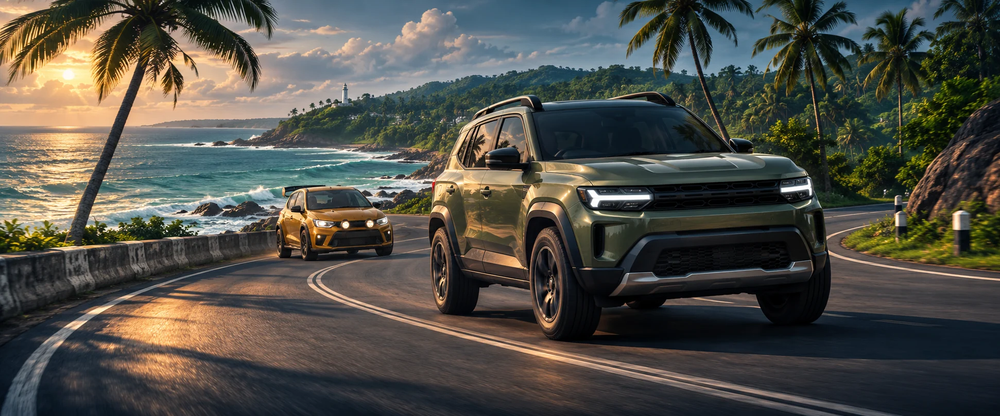

# Leo Racer

**A Windows arcade racer on Sri Lankan roads. Race solo against AI or share the screen with a second player.**

[**Download for Windows**](https://github.com/amilapcsgit/Leo_Racer/releases/tag/v2.8.0) · [Try the 2.8.1 playtest](https://github.com/amilapcsgit/Leo_Racer/releases/tag/v2.8.1-rc.3) · [Report a bug](https://github.com/amilapcsgit/Leo_Racer/issues/new)

*AI-generated promotional artwork inspired by Astra Lotus Coast.*

**21 cars · 6 drivers · 4 circuits · 1–2 local players · 1–10 laps · Offline play**

[Quick start](#quick-start) · [Circuits](#circuits) · [Controls](#controls) · [Build and mod](#build-and-mod) · [Credits and license](#credits-and-license)

## Quick start

| Build | Windows download |
|---|---|
| **Stable 2.8.0** | [Installer, portable ZIP and checksums](https://github.com/amilapcsgit/Leo_Racer/releases/tag/v2.8.0) |
| **2.8.1 playtest** | [Portable ZIP, checksums and known issues](https://github.com/amilapcsgit/Leo_Racer/releases/tag/v2.8.1-rc.3) |

1. Download the Windows 64-bit build. If you choose the portable ZIP, extract the entire archive into a fresh folder.
2. Run `LeoRacer.exe`. Use `Play Compatibility.cmd` if Forward+ gives you graphics problems or Vulkan is unavailable.
3. Select **Go Race**, choose **SOLO** or **SPLIT SCREEN**, pick a circuit and car, then select **START RACE**.

The game runs offline. Two local players can share a keyboard, use separate controllers, or mix input devices. To assign a controller, select **Assign Pad** for the player and press **A** on that controller. **Identify** helps distinguish identical pads.

## Race features

- **Arcade driving.** Drift to build charge, draft other cars for a slipstream, and use nitro or track boost pads.
- **Local split-screen.** Give each player a car, driver, control profile and camera. Race loading shows the saved keyboard, controller or wheel bindings for each active player.
- **Cockpit or chase.** Switch between Chase, Ghost and Cockpit. The Bigster, Duster My 2014 and Duster 2024 have reviewed cockpits with working instruments and mirrors.
- **Offline records.** Compare lap and race times. Handling presets and lap counts have separate records on the development branch.

*In-engine split-screen capture from 2.7.9. See the [cockpit and loading-screen gallery](docs/screenshots/2.7.9/README.md) for more.*

## Circuits

| Circuit | What to expect |
|---|---|
| **Astra Lotus Coast** | Oceanfront straights and sweeping coastal corners |
| **Colombo City Grand Prix** | A longer street circuit through Colombo |
| **Kandy Lake Circuit** | Lakeside corners in Sri Lanka's hill country |
| **Wennappuwa Street Circuit** | Unranked street racing in solo and local split-screen |

*AI-generated promotional artwork inspired by Kandy Lake Circuit.*

## Controls

These are the solo defaults. **Controls** shows the current bindings for each player and lets you remap a keyboard, controller or wheel.

| Action | Keyboard | Xbox-style controller |
|---|---|---|
| Steer | A / D or Left / Right | Left stick |
| Accelerate / brake | W / S or Up / Down | RT / LT |
| Drift | Space | A |
| Nitro | Shift | X |
| Recover | R | Y |
| Pause | Esc / P | Start |
| Horn | H | B |
| Change camera / look back | C / V | Right-stick click / left-stick click |
| Headlights | L | D-pad Left |
| Vehicle actions | O / K | D-pad Up / Down |
| Menu confirm / back | Enter / Esc | A or configured boost button / B |

## What's in 2.8

- **Stable 2.8.0** adds adaptive grass and water, Auto environment detail, refreshed Kandy scenery, recorded vehicle audio, and the fourth circuit at Wennappuwa. [Release notes](docs/RELEASE_NOTES_280.md) · [Validation](docs/VALIDATION_280.md)
- **2.8.1 playtest** adds Easy, Assisted and Standard handling presets and a Draw Distance option. The playtest also includes a fix for a false impact on the Wennappuwa circuit. [Playtest notes](https://github.com/amilapcsgit/Leo_Racer/releases/tag/v2.8.1-rc.3)
- **Current 2.8 branch** starts new profiles with Assisted handling, Astra Lotus Coast and two laps. It adds track-matched GrassField atlases and smaller boost pads with alternating positions. [Branch notes](docs/RELEASE_NOTES_281.md)

Track, renderer and player count affect performance. For bug reports, include your game version, Windows version, GPU, renderer, track, player count and steps to reproduce. [Report a bug](https://github.com/amilapcsgit/Leo_Racer/issues/new) · [Follow 1080p performance testing](https://github.com/amilapcsgit/Leo_Racer/issues/8)

## Build and mod

- **Vehicle Workshop.** Run `Vehicle Workshop.cmd` or open the in-game content tools to import custom vehicles and create transparent previews.
- **Media pack.** Find transparent cars, vectors, track outlines, artwork and attribution notes in `LeoRacer-2.7.1-Media-Pack.zip`. The included terms apply. [2.7.1 media pack release](https://github.com/amilapcsgit/Leo_Racer/releases/tag/v2.7.1)
- **Build from source.** Use Godot **4.7.2 .NET** and the pinned toolchain. The Windows packaging entry point is `tools/ultra_windows.ps1 -Package`. [Development setup](docs/COLOMBO_SETUP.md)

## Credits and license

**Author: L.J. Amila Prasad Perera.** I made Leo Racer for my son, **Shaven Leo**.

Original work is offered under the [custom non-commercial license](LICENSE) where the author holds the necessary rights. Earlier AGPL and MIT permissions remain in effect for material previously supplied under those terms. Third-party materials retain their own licenses. Share the official download link and check the applicable terms before redistributing or using the work commercially.

Kenney's Racing Starter Kit and City Kit are the foundation. The project also uses Rokojori, Terrain3D, EZ Tree, Quaternius foliage, AmbientCG maps, and other credited work. Third-party names, logos and characters belong to their respective owners. Leo Racer is an independent project.

[Third-party notices](licenses/) · [Astra artwork and audio](licenses/ASTRA_ASSETS.md) · [Sri Lankan assets](licenses/SRILANKA_ASSETS.md) · [Kandy attribution](licenses/Kandy-2.3.1.txt) · [Custom soundtrack](licenses/customaudio279.md)
