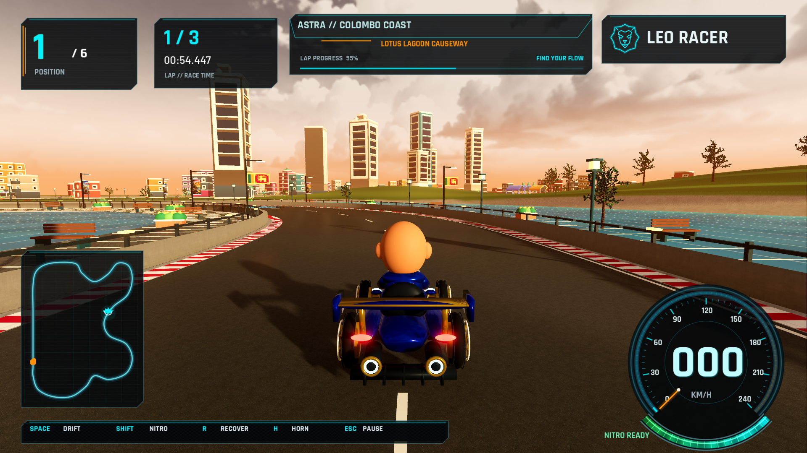
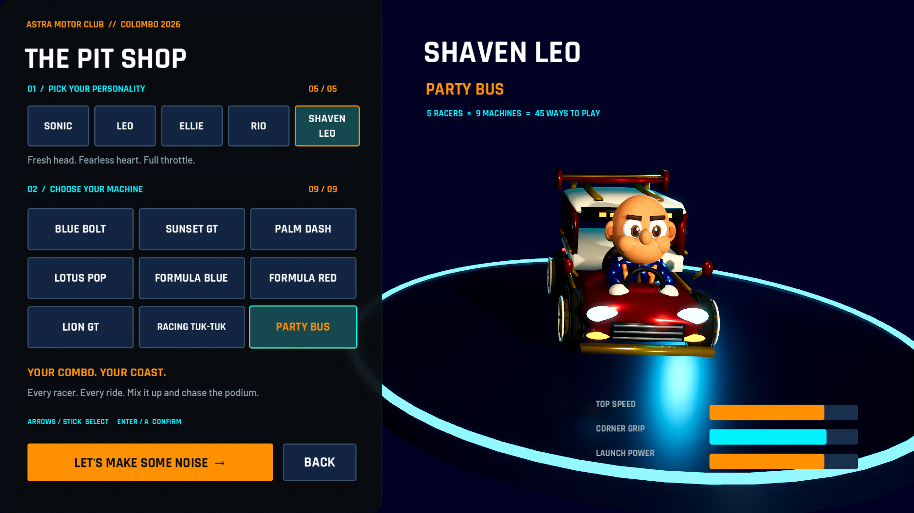

# Astra visual tour

The lap expands from 758 m to 1,905 m (2.51×), with new harbor esses, hairpin, lagoon causeway and garden turns. The previous Sri Lanka circuit remains in the source for rollback.

| Sri Lanka v1.3 coast | Astra v1.4 coast |
| --- | --- |
|  |  |

The new lower-right instruments retain their clean layout. The map now fits the full route, the header has a dark glass backing for sunset contrast, and position/lap guidance includes sector and corner information. Advertising uses bright shared emissive materials; generated road artwork uses transparent, mipmapped paint textures.

Five drivers and nine vehicles provide 45 combinations. Formula racers and Lion GT echo the festival poster styling; the racing tuk-tuk and Party Bus join every six-racer lineup. Shaven Leo is an original seated human character. Vehicle-specific seating, collision, wheel and exhaust metadata is shared between garage and race.

All 39 captures are recorded in [the capture manifest](qa-astra/captures/capture-manifest.json). Static tour/effect views are deliberately staged for framing; full-race behavior and performance are tested separately.
