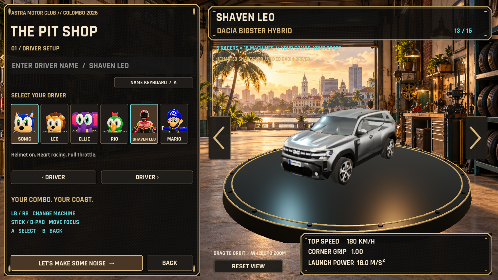
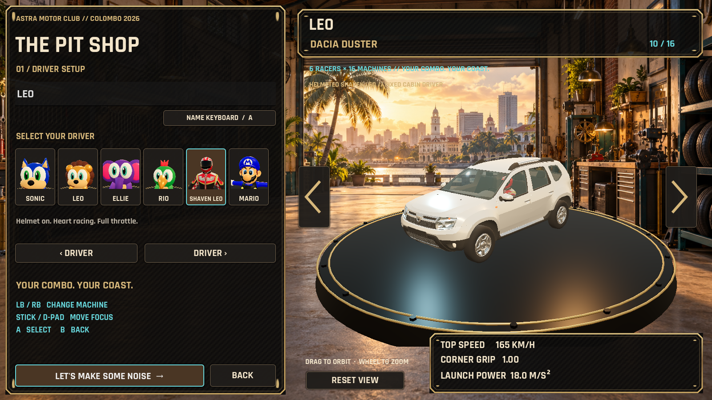
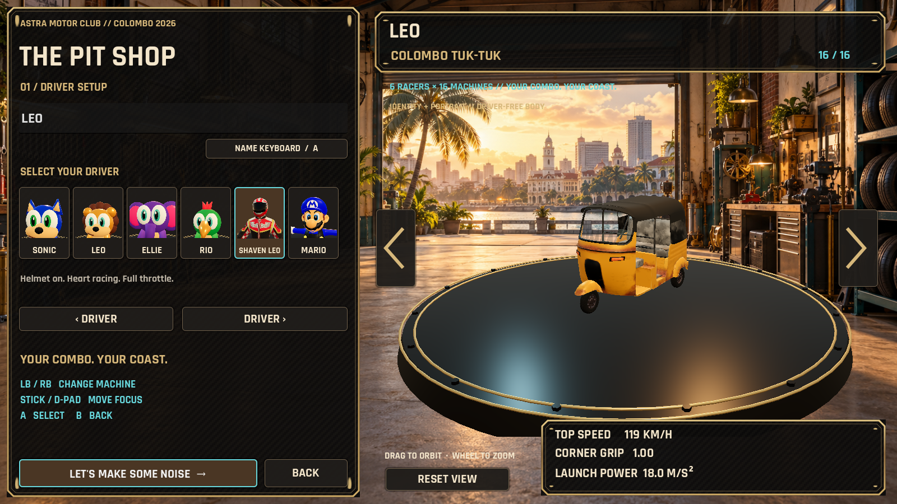
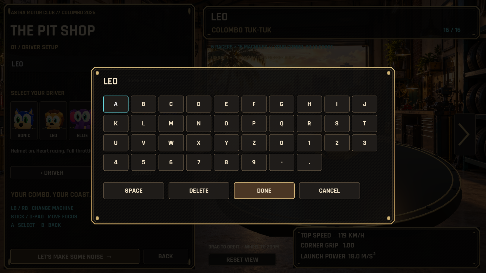

# v1.6.0-rc.1 — Bigster upgrade

Stable v1.5.0 remains available on `ModularGarage` and its release tag. `bigster`
starts at that published tag. The candidate installer uses **Leo Racer RC** as a
separate per-user install, registry entry and shortcut group. Playing is offline.

## Delivered behavior

The garage is a persistent live carousel with six driver portraits, custom name,
wraparound vehicle arrows, actual vehicle statistics, orbit/zoom/reset, and a
controller-operated name keyboard. LB/RB changes vehicles; D-pad/stick moves
focus; A activates; B returns. Text editing suppresses garage shortcuts. The
existing catalog, stable IDs and shared assembler remain the source of truth.

Pause → **Change Car** freezes and retains the race. Continue replaces only the
player in a collision-free lane at the same circuit distance, retaining elapsed
time, lap, ordered checkpoint and opponents. Speed is clamped and transient FX
are cleared. Back cancels pending choices; Start New Race restarts normally.
Changed races are visibly marked and excluded from best-time records.

| Vehicle | Dimensions / finish | Normal / boosted |
|---|---|---|
| 2011 Duster | 4.315 m length; 2.673 m wheelbase; white, black trim, clear glass | 165 / 198 km/h |
| Bigster approximation | 4.570 m length; 2.702 m wheelbase; graphite, clear glass, added cabin | 180 / 225 km/h |
| Colombo Tuk-Tuk | 2.635 × 1.300 × 1.700 m; 2.000 m wheelbase; yellow metal, matte canopy | Existing arcade preset |

The supplied “Bigster” is based on its authored 2024 Duster body. This release
improves that approximation; it does not claim an authentic new Bigster mesh.
Boosted figures are arcade settings. Dimension references: [first-generation
Duster](https://www.renault.com.uy/cars/duster/especificaciones.html), [Bigster
dimensions](https://www.user-manual.dacia.com/en/content/bigster/technical-specifications/information-about-vehicle/dimensions-metres),
and [Bajaj RE](https://cdn.globalbajaj.com/en/Brands/RE/RE4S-CNG).

Both Dacias use a fixed helmeted Shaven Leo inside, with a separate cabin pose.
Selected identity and custom name stay independent. Existing open karts use the
selected driver, with pelvis-anchored human fits. Other supplied vehicles remain
driver-free. Tire/rim groups use their own uniform scaling, hubs and radii;
stationary calipers are retained. The hover vehicle remains wheel-free.

## Evidence

- `qa-bigster/asset-measurements.json`: actual indexed geometry, wheelbase,
  circular tire sections and Compatibility-safe alpha glass.
- `qa-bigster/catalog.json`: all 96 combinations, visible-driver policies,
  measured-travel wheel animation, recovery, migration and independent GLB import.
- `qa-bigster/acceptance.json`: carousel persistence, name entry, synthetic Xbox
  inputs, layout at 720p/1080p/ultrawide, speed ceilings, braking regeneration,
  pause cancellation/continue/new-race and record exclusion: **37 checks passed**.
- `qa-bigster/fleet-race.json`: all sixteen vehicles complete three six-racer
  autonomous races with ordered checkpoints, including the faster Dacias.
- Driving and presentation regressions: 11 and 24 checks respectively.
- `qa-bigster/render-profile.json`: warmed-up full six-racer 1080p RTX A1000
  profile: **103.68 FPS average, p95 11.78 ms**, passing both targets.
- `qa-bigster/package-test.json`: extracted Vulkan/Compatibility and per-user
  install/upgrade/uninstall results: **all passed**, stable registry and settings unchanged. `stable-download-check.json` also verifies
  the actual public v1.5.0 ZIP hash and both rendering modes.

Synthetic controller events exercise the named Godot Xbox buttons and focus
paths; physical-button testing is not included in these automation results. Engine
texture cleanup diagnostics at shutdown remain documented in the v1.5 validation
report and are separated from runtime failures.

## Comparison captures

Before: [v1.5 workshop](qa-modular-garage/garage-1920x1080.png).

## Asset preparation and editing

Original `sources/` inputs and all v1.5 prepared GLBs remain unchanged. Runtime
derivatives are under `assets/models/bigster`; their input hashes and target
dimensions are recorded in `derivative-specs.json`. The original authors and
licenses remain in `licenses/MODULAR_ASSETS.md` and the v1.5 provenance manifest.

1. Install the pinned runtime with `tools/setup_windows.ps1`.
2. Run `python tools/prepare_bigster_assets.py` (NumPy/Pillow). It maps body
   sections around axle stations and transforms wheels uniformly about their hubs.
3. With supplied driver sources available, run Blender in background with
   `blender/prepare_bigster_driver.py`, then `blender/prepare_dacia_driver.py`.
4. `blender/bigster_authoring.py` creates editable `.blend` copies in
   `build/bigster-authoring`. Runtime GLBs are self-contained and editable too.
5. Run `tools/run_godot.ps1 --headless --editor --import --quit`, then the model
   verifier, catalog test and `tests/bigster_acceptance.gd`. Real-renderer captures
   use `-- --drive-test --visual-test`; headless tests omit `--visual-test`.

The generic editor dock still adds future cars/drivers without gameplay or UI
code changes. `VehicleDefinition` now exposes boosted speed, electric feedback,
braking regeneration, AI cornering limits, fixed driver ID/model and keyed seat
fits. Zero boosted speed retains the original arcade multiplier. Addon and build
setup remain checksum-pinned; Rokojori sources are fetched officially, never
committed separately. Version tags publish only after CI gates pass.
