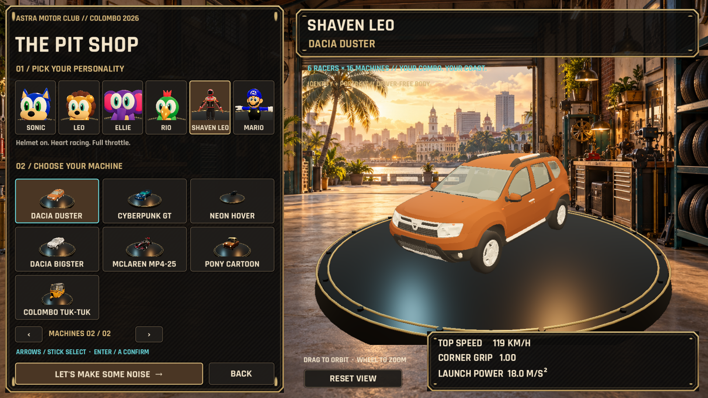
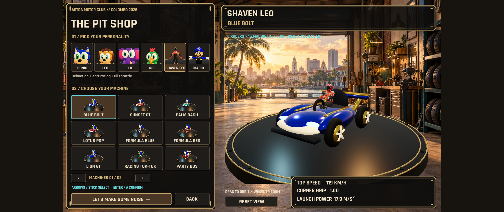

# Leo Racer v1.5 — add a car or driver



Open this project with the pinned **Godot 4.7.2 .NET** editor using `tools/run_godot.ps1 -Editor`. Gameplay and the garage are GDScript; the existing Rokojori feedback bridge remains C#. Keep `sources/` read-only. The runtime copies live under `assets/models/`, separate from conversion inputs.

## Editor workflow

1. Enable **Leo Modular Garage** under Project → Project Settings → Plugins if its dock is hidden. Enter a unique stable ID and display name. Choose **Vehicle GLB** or **Driver GLB**, then **Copy GLB & create draft**. The original stays untouched; a self-contained copy and SHA-256 provenance record are saved under `assets/models/user/<id>/`.
2. The draft opens in the Inspector. For a vehicle, configure the normalization transform so **+Y is up, −Z is forward, and the tires meet the ground**. Use uniform scale. Set collider size/position, maximum speed, acceleration, handling, exhausts, preview target/distance and driver policy. `IDENTITY_ONLY` keeps a supplied car driver-free; `SEATED` adds the selected racer's seated model.
3. Recognizable wheel names are proposed automatically. Review every `WheelBinding`: rotating node paths, stationary caliper paths, steering flag, vehicle-space pivot and axle, and **individual radius in metres**. Imported groups with offset geometry need their actual hub center entered. A fused body requires offline partitioning first; the tool does not guess hidden wheel faces. Mark a wheel-free vehicle `hovering`; this adds presentation motion without changing driving physics.
4. For a driver, assign standing and seated PackedScenes, orientation/seat offset and optional material-name/albedo binding. A material binding affects only the named material. Bake a seated pose in Blender when the source is a standing rig.
5. Set `setup_complete` only after reviewing a vehicle. Click **Validate, render card & publish**. Missing IDs/models, unresolved groups, incomplete setup and unbound non-hover wheels are rejected. Drafts are excluded from Windows exports. A successful publish saves an actual rendered PNG and appends the definition to `assets/catalog/catalog.tres`.
6. Open the garage. Driver pages contain six cards and vehicle pages contain nine. More pages appear automatically. Test the asset in a race, reverse, drift, recovery and both renderers. Run **Validate playable catalog** before exporting; the release script below enforces validation as well.



The driver ID `human` still means **Shaven Leo**. His model, portrait, garage preview, player and AI appearances now use the supplied helmeted racer. `mario` is the sixth identity. All seven supplied vehicles intentionally omit an added driver. The other nine retain a visible seated driver.

## Resource map

| Resource | Purpose |
|---|---|
| `VehicleDefinition` | Stable ID, model/normalization, wheels, collision, handling, camera, seat, exhausts and driver policy |
| `DriverDefinition` | Stable ID, both poses, orientation, portrait and material-specific texture binding |
| `WheelBinding` | Rotating groups, stationary calipers, pivot, axle, steering and measured tire radius |
| `GarageCatalog` | Ordered editor-managed resources; stable-ID lookup and migration from old numeric saves |
| `VehicleAssembler` | Shared assembly for live showroom, cards, player and AI |

The selector exposes `selection_changed(driver_id, vehicle_id)`, `race_requested(driver_id, vehicle_id)` and `back_requested`. Its `SubViewportContainer → SubViewport → Garage3D` has a separate World3D. Hidden previews stop rendering; Reduced Motion stops automatic orbit. Drag to orbit, use the wheel to zoom, and **Reset View** to restore framing. Native Godot buttons provide mouse, keyboard and controller focus.

## Rebuild supplied assets offline

With Python + NumPy and Blender 4.5:

```powershell
python tools/prepare_modular_assets.py
blender --background --python blender/prepare_modular_drivers.py
python tools/build_modular_catalog.py
./tools/run_godot.ps1 --headless --editor --import --quit
./tools/run_godot.ps1 --script res://tools/render_modular_thumbnails.gd
./tools/run_godot.ps1 --headless --editor --import --quit
```

`prepare_modular_assets.py` retains source accessor bytes and embedded images. It partitions triangle index lists, preserving positions, normals, UVs, materials and source proportions. It groups the Duster/Cyberpunk named wheels, separates the Bigster/Pony/McLaren fused wheel components, binds the tuk-tuk's single front and paired rear wheels, and leaves the hovercar wheel-free. Brake calipers steer but never enter spinning groups. Pony's two-triangle preview floor is the sole excluded source geometry. The Blender driver pipeline removes the importer's generated Icosphere bone-display helper, normalizes the evaluated skeleton, poses arms/legs and exports static seated/standing GLBs.

`asset-provenance.json` records filenames, hashes, authors, embedded license metadata, normalization matrices, partition assignments and preservation checks. The exact embedded `Wolf3D_Headwear` PNG is extracted as `assets/models/modular/helmet_driver.png`. See [asset notices](../licenses/MODULAR_ASSETS.md).

The bootstrap catalog command recreates the initial 16 × 6 roster. **Do not run it over a customized catalog**; use the editor dock for subsequent additions. It is intended for reproducing this release from the supplied originals.

## Build and validation

Run `tools/build_modular_release.ps1` from PowerShell. It validates the catalog and wheel bindings, builds the existing .NET project, then exports a self-contained Windows package. The existing dependency setup in [COLOMBO_SETUP.md](COLOMBO_SETUP.md) supplies the pinned engine, matching templates, SDK, Terrain3D and licensed Rokojori integration. Standard editor exports also follow the catalog's explicit PackedScene/Texture2D references; no runtime directory scanning or absolute source paths are needed.

Selections are saved as `driver_id`/`vehicle_id` in the existing config. Old numeric fields migrate through the frozen legacy order. Audio, Reduced Motion, fullscreen and Astra race records remain in that same config.

The brass SVG kit is authored vector artwork; text remains live Godot labels. The workshop PNG was created with the built-in image-generation tool; its exact prompt is saved in `assets/art/garage/workshop-prompt.json`. Model cards are real Godot renders. Showroom metallic reflections use the [Godot sky reflection source](https://docs.godotengine.org/en/4.5/classes/class_environment.html).
