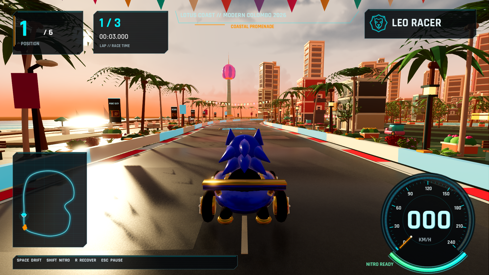
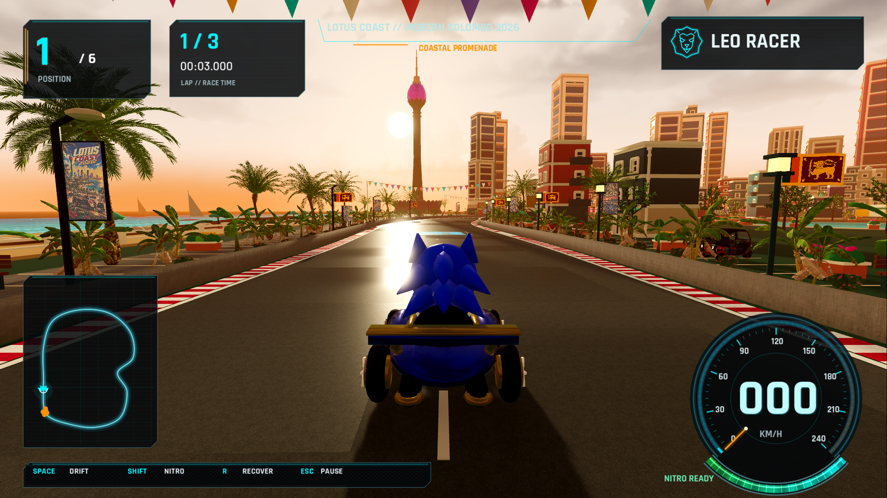
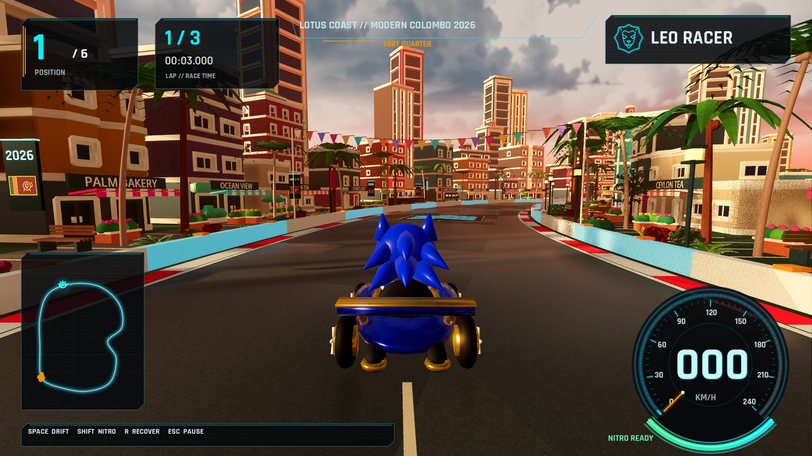
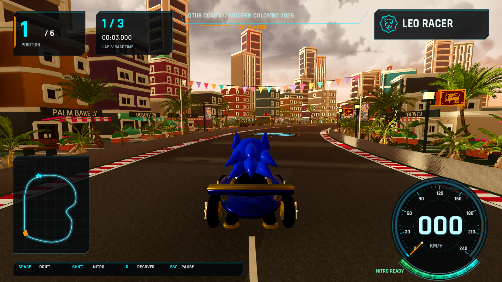
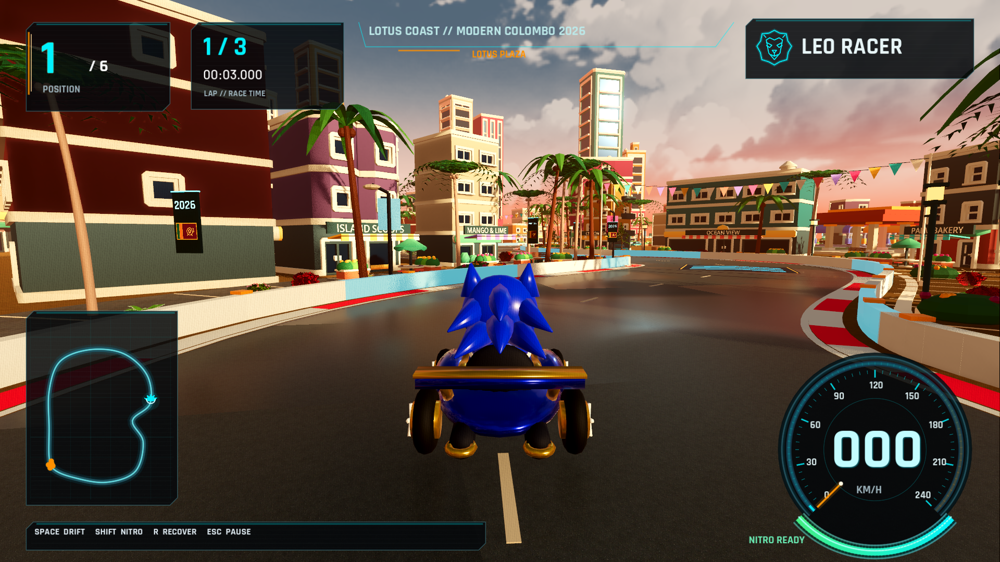
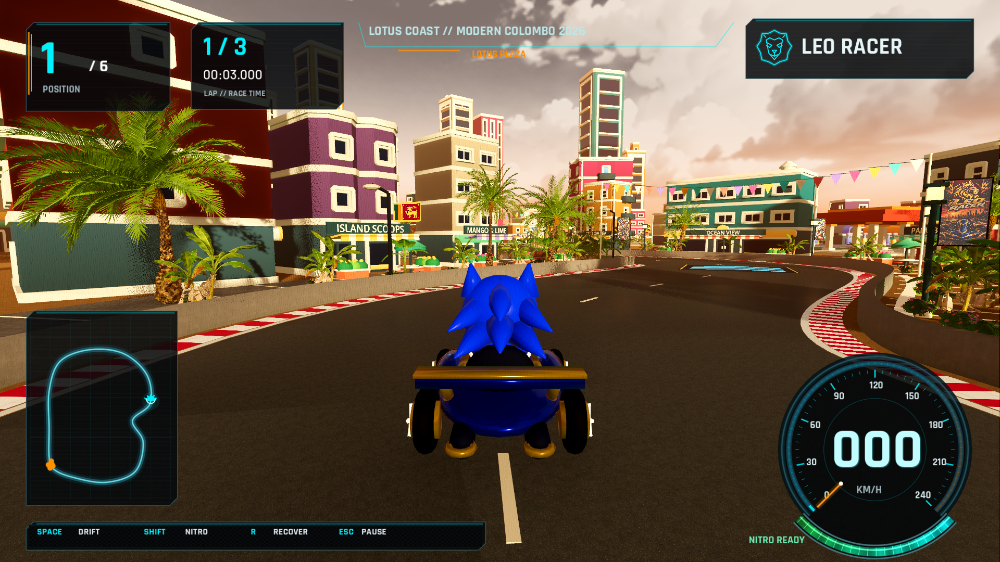
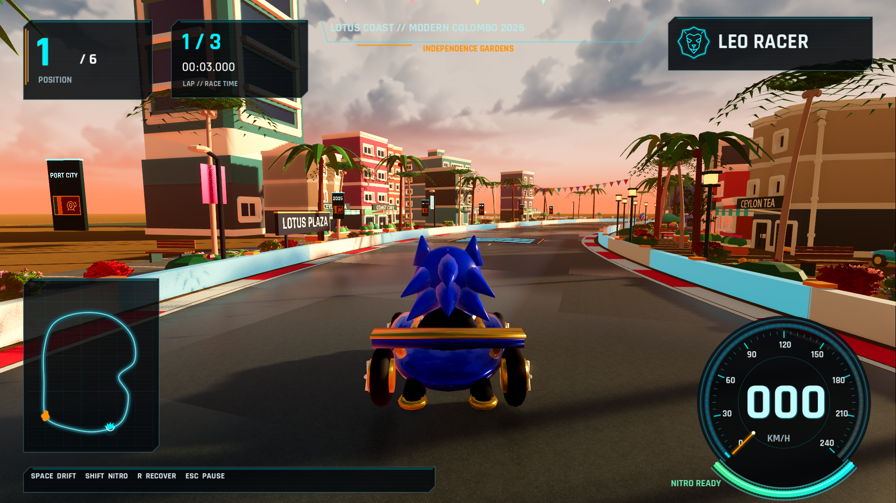
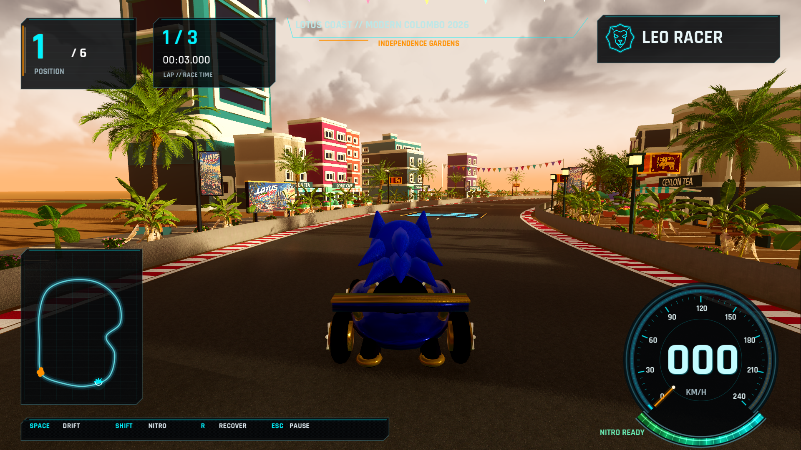

# Colombo to Sri Lanka — matching captures

The camera positions, kart, and circuit viewpoints match the prior Colombo tour.

| District | Colombo v1.2 | Sri Lanka v1.3 |
| --- | --- | --- |
| Coast |  |  |
| Fort |  |  |
| Lotus Plaza |  |  |
| Gardens |  |  |

Additional captures: [national flag](qa-srilanka/flag.png),
[festival artwork](qa-srilanka/billboard.png), [bus](qa-srilanka/bus.png),
[street-art tuk-tuk](qa-srilanka/tuk-tuk.png), [boost](qa-srilanka/boost.png),
[speed lines](qa-srilanka/speed-lines.png), and [drift](qa-srilanka/drift.png).
Main menu, garage, guide, settings, pause and results captures are also retained.
Generated source PNGs and exact prompts are in `assets/art/srilanka/`.
